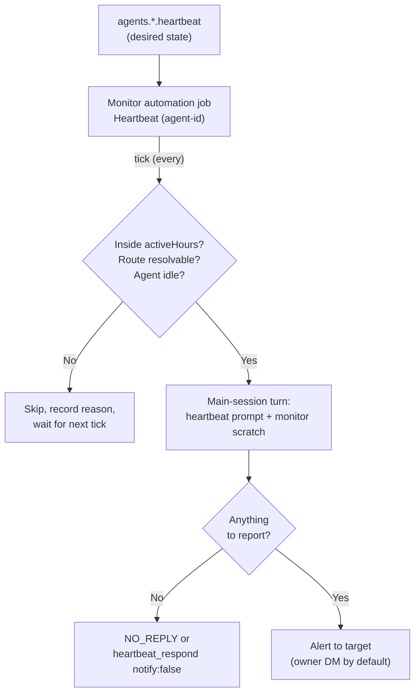

---
last_update:
  date: 2026-10-18
verified_with: 2026.10.4
title: Heartbeat System
description: How the heartbeat works inside the Gateway in v2026.10 — the system-owned monitor automation, monitor scratch, event wakes, delivery routing and busy deferral
keywords: [openclaw, heartbeat, monitor scratch, automations, scheduling, multi-agent]
---

# Heartbeat System

The heartbeat is a periodic agent turn that lets OpenClaw act without being prompted. Since v2026.8.1 it is a **system-owned automation**: the same Automations scheduler that runs your cron jobs keeps one monitor job per heartbeat-enabled agent. This page explains the moving parts. For setup and recipes, see the [Heartbeat Guide](/guides/heartbeat).

---

## How it works



1. **Config is desired state.** `agents.defaults.heartbeat` and `agents.entries.<id>.heartbeat` describe what you want. The Gateway writes them through to monitor rows at startup and on config reload. `openclaw doctor --fix` can create missing or stale rows before the next start. Edit the config, not the job.
2. **The monitor job owns the tick.** It is listed in `openclaw cron list --all` as `Heartbeat (<agent-id>)`, with its own run history (`openclaw cron runs <jobId>`).
3. **Each tick is one turn in the main session** (`agent:<id>:main` by default). The prompt is sent verbatim as the user message; there is no heartbeat-specific system prompt. With `isolatedSession: true` the turn runs in a fresh session instead, and with `lightContext: true` the workspace bootstrap files are skipped.
4. **The reply contract** is `NO_REPLY` (or `heartbeat_respond` with `notify: false`) for nothing to report, and plain alert text (or `notify: true` with `notificationText`) otherwise.

Scheduled heartbeats depend on automations. If `cron.enabled` is `false` or `OPENCLAW_SKIP_CRON=1` is set, they do not run. There is no separate heartbeat timer.

---

## What goes into the prompt

The default prompt tells the agent to follow the monitor scratch when present, keep recurring work in automations, not to revive old tasks from earlier chats, and to reply `NO_REPLY` when nothing needs attention. You can replace it with `heartbeat.prompt`; the replacement is not merged with the default.

The **monitor scratch** is a private text record per monitor job, stored in the shared state database and appended to the prompt. It replaced `HEARTBEAT.md`, which the runtime no longer reads. Manage it with `openclaw cron scratch <jobId>`; the agent can rewrite it by passing `scratch` to `heartbeat_respond`. If scratch exists but is effectively empty, the run is skipped (`reason=empty-heartbeat-file`).

Scratch is context, not a schedule. Anything that needs its own cadence ("every morning", "hourly") belongs in its own automation job. Doctor converts old `HEARTBEAT.md` `tasks:` blocks into such jobs; see [Migrating from HEARTBEAT.md](/guides/heartbeat#migrating-from-heartbeatmd), including the warning that bare legacy `interval` numbers are read as minutes.

---

## Scheduling and guards

- **Cadence:** `every`, default `30m` (or `1h` when Anthropic auth resolves to OAuth/token and `every` is unset). A duration string; a bare number is minutes. `"0m"` disables the recurring cadence but keeps the job, its scratch and event-driven wakes.
- **Active hours:** `activeHours: { start, end, timezone }` is an allow-window. Ticks outside it are skipped until the next tick inside. Equal `start` and `end` means a zero-width window, so the heartbeat never runs.
- **Busy deferral:** a plain scheduled poll does not queue behind other work. If the main queue is busy, an automation targets the same agent or session, or the agent has an active run, the poll is recorded as skipped and waits for its next tick. Wakes that carry queued events still retry.
- **Event wakes:** node completions and similar events can wake the heartbeat between ticks, even with `every: "0m"`. They are rate-limited per agent: at least 30 seconds apart and a flood guard after five starts in 60 seconds.
- **Channel readiness:** if the delivery channel reports it is not ready, ambient polls skip the model call and back off from one minute up to the cadence.

---

## Delivery routing

| `target` | Delivers to |
|---|---|
| `owner` (default) | The first concrete entry in `commands.ownerAllowFrom`, then a channel `allowFrom`. Never a group. No owner means `reason=no-route` and no model call |
| `last` | The last external conversation, including groups |
| `<channel id>` | That channel, with `to` as the recipient (for example `target: "telegram"`, `to: "123456789"`) |
| `none` | Nothing external; internal state only |

`directPolicy: "block"` suppresses DM deliveries (`reason=dm-blocked`). What reaches the chat is further controlled by `channels.*.heartbeatVisibility` (`showOk`, `showAlerts`, `useIndicator`); with all three off, the run is skipped (`reason=alerts-disabled`).

---

## Multi-agent

`agents.defaults.heartbeat` applies to all agents and per-agent blocks merge on top. If any agent in `agents.entries` has a `heartbeat` block, only those agents run heartbeats. Each agent's monitor job has its own scratch and schedule.

```json5 title="~/.openclaw/openclaw.json"
{
  agents: {
    ownership: "explicit",
    defaults: {
      systemAgent: { agentId: "alex" },
      heartbeat: { every: "30m", isolatedSession: true },
    },
    entries: {
      alex: {
        workspace: "~/.openclaw/workspace",
        model: "anthropic/claude-opus-5-5",
        heartbeat: { every: "30m" },
      },
      monitor: {
        workspace: "~/.openclaw/workspace-monitor",
        model: "anthropic/claude-haiku-5-5",
        heartbeat: { every: "10m", lightContext: true },
      },
      reporter: {
        workspace: "~/.openclaw/workspace-reporter",
        model: "anthropic/claude-sonnet-5-5",
      },
    },
  },
}
```

`alex` and `monitor` run heartbeats; `reporter` does not, and its weekly report would be an automation job created with `--agent reporter`.

---

## Cost

Each heartbeat is a full agent turn, so cost scales with cadence × prompt size × model price. The prompt is dominated by session history unless `isolatedSession` is on (upstream estimates about 100K tokens down to 2–5K per run). The levers, in rough order of impact: `isolatedSession`, a cheaper `model`, a longer `every`, `activeHours`, `lightContext`, and a small scratch. Worked settings are in the [Heartbeat Guide](/guides/heartbeat#cost-optimization). This page does not quote model prices; check your provider's pricing page.

Without `isolatedSession`, a heartbeat on a small model can leave that model on the shared main session, which may then overflow on your next turn ("heartbeat model bleed").

---

## Dreaming

Dreaming (memory consolidation) is owned by the `memory-core` plugin and has its own schedule (`plugins.entries.memory-core.config.dreaming.frequency`). It is independent of the heartbeat and has been on by default since v2026.8.1. See [Dreaming](https://docs.openclaw.ai/concepts/dreaming).

---

## Debugging

```bash
openclaw logs --follow                  # gateway log
openclaw system heartbeat last --json   # last heartbeat outcome
openclaw cron list --all                # find Heartbeat (<agent>) and its id
openclaw cron runs <jobId> --limit 20   # run history, including skip reasons
openclaw system event --text "Check now" --mode now   # immediate heartbeat
```

| Problem | Likely cause | Fix |
|---|---|---|
| Never fires | No monitor row, `cron.enabled: false`, `every: "0m"`, or another agent has a heartbeat block and this one does not | `openclaw doctor --fix`; check config |
| Skipped with `no-route` | No resolvable owner | Set `commands.ownerAllowFrom`, or `target` + `to` |
| Skipped with `empty-heartbeat-file` | Scratch is blank or only headings | Write a real checklist or `--unset` it |
| Old `HEARTBEAT.md` ignored | Retired file | `openclaw doctor --fix` imports it into scratch |
| Fires at the wrong time | `activeHours.timezone` or `agents.defaults.userTimezone` | Set an IANA timezone |
| Config rejected | Top-level `heartbeat`, `interval`, `quiet_hours`, `enabled` | Use `agents.defaults.heartbeat.every` / `activeHours` |

---

## See also

- [Heartbeat Guide](/guides/heartbeat): setup, recipes, full field reference
- [Automation Guide](/guides/automation): user-authored automation jobs
- [Architecture Overview](/architecture/overview): where the heartbeat fits
- [Multi-Agent Workflows](/guides/multi-agent): per-agent configuration
- Official docs: [Heartbeat](https://docs.openclaw.ai/gateway/heartbeat), [Automations](https://docs.openclaw.ai/automation/cron-jobs)
