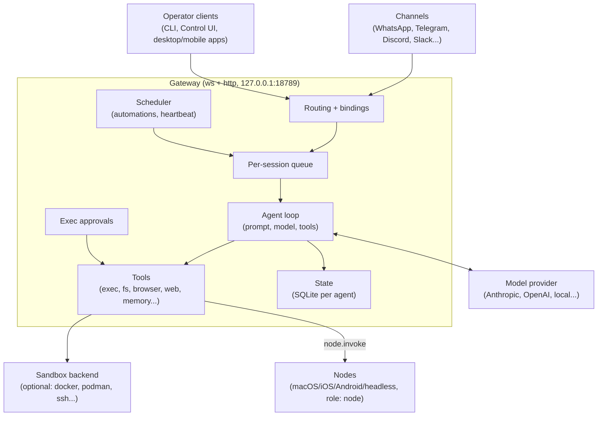
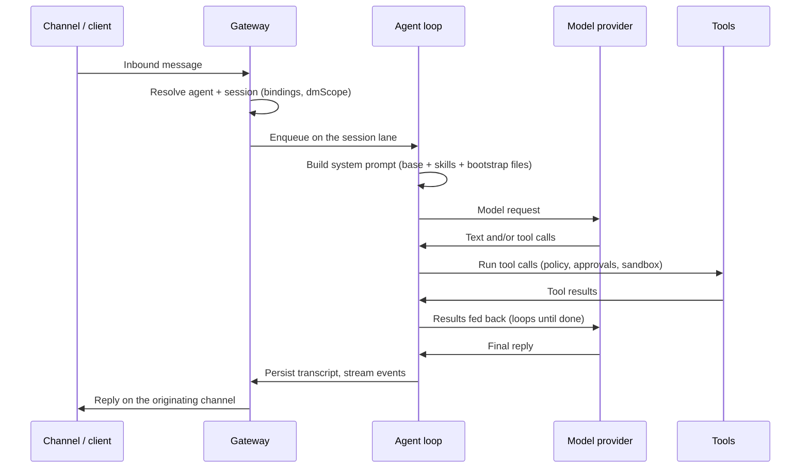

---
last_update:
  date: 2026-10-18
verified_with: 2026.10.4
title: Architecture Overview
description: How OpenClaw's Gateway-centric architecture fits together — the Gateway, clients, nodes, the agent loop, tools, the workspace, and where state lives on disk
keywords: [openclaw, architecture, system design, components, gateway, data flow, request lifecycle]
---

# Architecture Overview

OpenClaw runs one long-lived **Gateway** process per host. The Gateway owns every messaging channel, runs the agent loop for each session, executes tools, and serves a WebSocket + HTTP API on one port (default `127.0.0.1:18789`). Everything else (the CLI, the Control UI, the desktop and mobile apps, and paired "node" devices) is a client of that Gateway.

This page is a map. The official reference is [Gateway architecture](https://docs.openclaw.ai/concepts/architecture) and [Agent loop](https://docs.openclaw.ai/concepts/agent-loop).

## High-level architecture

## Components

| Component | Role | Read more |
|-----------|------|-----------|
| **Gateway** | The single process: channels, WebSocket API, agent runs, scheduler, Control UI | [Gateway](/architecture/gateway) |
| **Agent runtime** | The agent loop: assembles the prompt, calls the model, runs tools, streams the reply | [Agent runtime and tools](/architecture/brain-and-hands) |
| **Tools** | `exec`, `read`/`write`/`edit`/`apply_patch`, `browser`, `web_search`/`web_fetch`, `memory_search`, messaging, sessions, and plugin/MCP tools | [Agent runtime and tools](/architecture/brain-and-hands) |
| **Sandbox** | Optional isolation for tool execution. **Off by default.** | [Sandboxing (official)](https://docs.openclaw.ai/gateway/sandboxing) |
| **Nodes** | Companion devices that expose commands such as `camera.*` and `screen.record`; they do not run a Gateway | [Nodes (official)](https://docs.openclaw.ai/nodes) |
| **Memory** | Markdown files in the agent workspace, plus a search index in the agent database | [Memory System](/architecture/memory-system) |
| **Heartbeat and automations** | Scheduled agent turns, run by the Gateway scheduler | [Heartbeat](/architecture/heartbeat) |
| **Channels** | Messaging integrations, mostly bundled plugins | [Channels](/guides/channels) |
| **Skills** | Directories with a `SKILL.md` that teach the agent a task | [Skills](/guides/skill-development) |
| **Bindings** | Route messages to agents by channel, account, or peer | [Multi-Agent](/guides/multi-agent) |

## Request lifecycle

When a message arrives (from a channel, the CLI, the Control UI, or a scheduled job):

Runs are serialized per session, so two messages to the same session never race ([Command queue](https://docs.openclaw.ai/concepts/queue)).

### What goes into the prompt

The system prompt is built from OpenClaw's base prompt, the skills prompt, the workspace bootstrap files, and per-run overrides ([System prompt](https://docs.openclaw.ai/concepts/system-prompt)).

| Source | Notes |
|--------|-------|
| `AGENTS.md` | Operating instructions. Its `## Tools` section replaces the retired `TOOLS.md`. |
| `SOUL.md` | Persona, tone, boundaries |
| `USER.md` | Optional user model, separate 4,000-character budget |
| `IDENTITY.md` | Name, vibe, emoji |
| `MEMORY.md` | Curated long-term memory, main private session only |
| Skills | Names and descriptions of eligible skills |
| Conversation history | The session transcript, subject to compaction |

Bootstrap files are truncated when injected: `agents.defaults.bootstrapMaxChars` (default 20000) per file and `bootstrapTotalMaxChars` (default 60000) in total ([Agent workspace](https://docs.openclaw.ai/concepts/agent-workspace)). Daily notes in `memory/` are not injected; the agent retrieves them with the `memory_search` tool. Untrusted tool and channel content is wrapped in `EXTERNAL_UNTRUSTED_CONTENT` markers before the model sees it.

## Design notes

- **One process per host.** One Gateway owns the channels and state for a host. Scale up, or run separate Gateways with separate state directories ([Multiple gateways](https://docs.openclaw.ai/gateway/multiple-gateways)).
- **Local state, cloud models.** Config, transcripts, and memory live on your disk. Whatever goes into a prompt, including memory, is sent to your model provider. Memory search uses OpenAI embeddings by default, so memory chunks also go to the embedding API unless you pick a local provider.
- **Model-agnostic.** Model refs are `provider/model` (for example `anthropic/claude-opus-5-5`), with fallbacks under `agents.defaults.model`. See [Model Selection](/guides/model-selection).
- **Extensible.** Channels, providers, memory backends and many tools are plugins. Skills are directories with a `SKILL.md`.
- **Strict config.** `openclaw.json` is validated against a schema, and the Gateway refuses to start on unknown keys. Check with `openclaw config validate`.

:::warning Defaults are permissive
The Gateway binds to loopback and requires token auth by default. But host `exec` defaults to `tools.exec.mode: "full"` (no approval prompts), and sandboxing defaults to `off`. If the agent can reach a shell, set `tools.exec.mode` to `ask` or `allowlist`, and consider `agents.defaults.sandbox.mode`. See [Security Hardening](/security/hardening).
:::

## Key files

| Path | Purpose |
|------|---------|
| `~/.openclaw/openclaw.json` | Main configuration (JSON5) |
| `~/.openclaw/.env` | Global fallback for environment variables such as API keys |
| `~/.openclaw/workspace/` | Agent workspace: `AGENTS.md`, `SOUL.md`, `USER.md`, `IDENTITY.md`, `MEMORY.md`, `memory/`, `skills/` |
| `~/.openclaw/agents/<agentId>/agent/openclaw-agent.sqlite` | Per-agent database: model auth profiles, sessions, transcripts, memory index |
| `~/.openclaw/state/openclaw.sqlite` | Shared state database |
| `~/.openclaw/credentials/` | Channel and provider state, legacy OAuth imports |
| `~/.openclaw/skills/` | Managed (installed) skills |
| `/tmp/openclaw/openclaw-YYYY-MM-DD.log` | Gateway log file ([Logging](https://docs.openclaw.ai/logging)) |

`HEARTBEAT.md` and `TOOLS.md` are retired. If you still have them, `openclaw doctor --fix` migrates their content.

## Deep dives

- [Gateway](/architecture/gateway): wire protocol, auth, pairing, service management
- [Agent runtime and tools](/architecture/brain-and-hands): the agent loop, tools, exec approvals, sandboxing, nodes
- [Memory System](/architecture/memory-system): memory files, hybrid search, dreaming
- [Heartbeat](/architecture/heartbeat): scheduled check-ins
