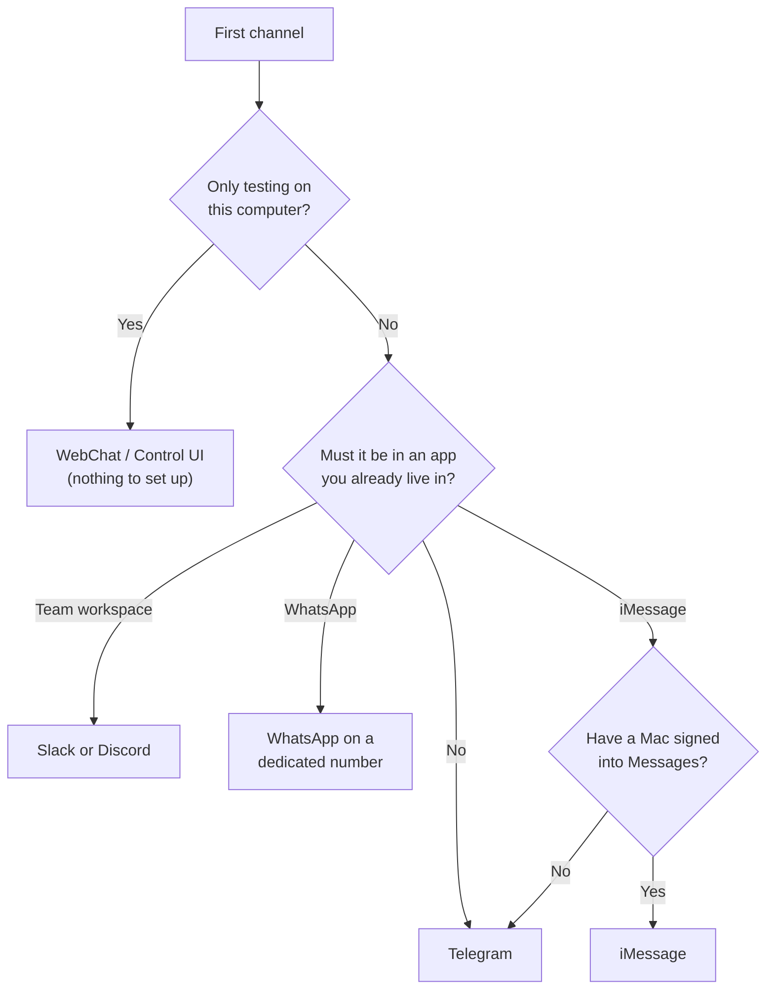
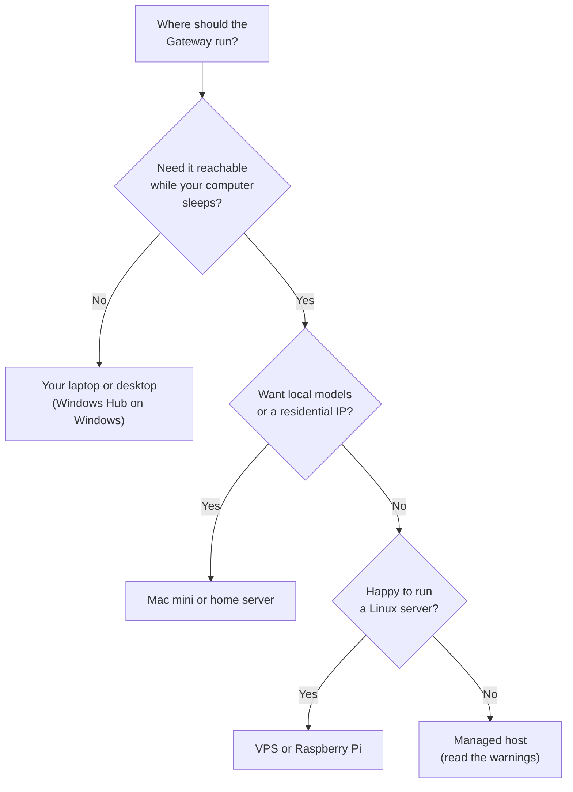

---
last_update:
  date: 2026-10-18
verified_with: 2026.10.4
title: Choosing Your Setup
description: Opinionated decision guides for new OpenClaw users — which model for which budget, which chat channel to start with, where to run the Gateway, and a secure-by-default checklist
keywords: [openclaw, openclaw setup, which model, openclaw budget, openclaw telegram vs whatsapp, openclaw raspberry pi, openclaw vps, openclaw mac mini, openclaw security checklist]
---

# Choosing Your Setup

The official docs explain every option and mostly leave the choice to you. This page makes the choice: four decisions a new user faces, each with a recommendation, the numbers behind it, and links to the pages with the details. Checked against OpenClaw **v2026.10.4** on 2026-10-18. Prices change; every figure here is dated.

If you have not installed yet, read this first, then follow [Installation](/getting-started/installation) and the [Quick Start](/getting-started/quick-start).

## 1. Which model for which job and budget {#models}

You choose three things: a **main model** for chat and agent work, a cheaper **utility and heartbeat model** for background tasks, and **fallbacks** for when the main model fails.

One rule overrides the budget. Upstream's security guidance says smaller and cheaper models are "more susceptible to tool misuse and instruction hijacking", and to use "the latest-generation, best-tier model for any bot that can run tools or touch files/networks" ([prompt injection](https://docs.openclaw.ai/gateway/security/prompt-injection)). So a cheap model is fine for chat, summaries and low-risk background checks. An agent that runs unattended with shell, browser or email access, or reads untrusted content, should get a strong model, or have its tools cut down to match a weak one.

### What a month costs

Assumption for every row: 600 model requests a month (20 a day), 25K input tokens and 1K output tokens each, no cache hits. One chat message with tool calls can be several requests. Prices per million tokens as of 2026-10-18, from [Cost Management](/guides/cost-management#model-prices-used-on-this-page) (Anthropic's pricing page; DeepSeek is OpenClaw's bundled peak-rate estimate).

| Main model | Price (in / out) | Per request | Per month |
|---|---|---:|---:|
| `anthropic/claude-haiku-5-5` | $0.10 / $0.50 (prompts up to 100K) | $0.003 | $1.80 |
| `deepseek/deepseek-flash` | $0.30 / $1.20 | $0.0087 | $5.22 |
| `anthropic/claude-sonnet-5-5` | $2 / $10 | $0.06 | $36.00 |
| `anthropic/claude-opus-5-5` | $4 / $20 | $0.12 | $72.00 |
| `anthropic/claude-fable-5-1` | $10 / $50 | $0.30 | $180.00 |

Caching changes this a lot: a cache read costs $0.10 per million on Sonnet 5.5 instead of $2. Measure your own numbers with `/usage full` and `openclaw gateway usage-cost --days 7`, then redo the sum with the [formula](/guides/cost-management#estimate-before-you-pay). Heartbeats are extra; the [heartbeat cost table](/guides/cost-management#heartbeat-costs) prices them per model.

### Recommendation by budget

| Budget | Main model | Utility and heartbeat | Fallbacks | Tools |
|---|---|---|---|---|
| Under $10/mo | Haiku 5.5 | Haiku 5.5, lean heartbeat every 2h | DeepSeek Flash | Chat and messaging only; no exec |
| About $30/mo | Sonnet 5.5 | Haiku 5.5, lean heartbeat every 1h | Haiku 5.5 | Exec with approvals (`ask`) |
| No limit | Opus 5.5 (the default for fresh Anthropic setups) | Haiku 5.5 utility; Sonnet 5.5 heartbeat | A different provider first, then Sonnet 5.5 | Full, with approvals and the sandbox for untrusted input |
| Fully local / private | Qwen3 32B via Ollama (24 GB VRAM or a 32 GB+ Apple Silicon Mac) | Qwen3 14B | Another local model, never a cloud one | Sandbox everything; approvals on |

Why:

- **Fallbacks on another provider.** OpenClaw rotates auth profiles inside one provider before it moves to the next fallback ([Model Selection](/guides/model-selection#model-routing)). A fallback from a second provider is what survives an outage.
- **Heartbeats unattended.** A heartbeat that only checks and notifies can run on Haiku. If it acts on email or web content, it is an unattended tool-using agent, so give it a strong model. Lean heartbeats (`isolatedSession` plus `lightContext`) cost about a tenth of full-context ones.
- **Spend limits live at the provider.** OpenClaw has no built-in budget cap. Set one in the provider console or on an OpenRouter key ([hard limits](/guides/cost-management#hard-limits-at-the-provider)).
- **A plan you already pay for** (Claude Pro or Max via Claude CLI auth, a ChatGPT plan via Codex OAuth) can replace per-token billing, with the caveats in [Cost Management](/guides/cost-management#6-use-a-subscription-you-already-have).

**Under $10/mo.** About $1.80 of chat at the usage above, plus $0.26 a month for 7 lean Haiku heartbeats a day ($0.00125 each). The cheap model gets no shell:

```json5 title="~/.openclaw/openclaw.json"
{
  agents: {
    defaults: {
      model: {
        primary: "anthropic/claude-haiku-5-5",
        fallbacks: ["deepseek/deepseek-flash"],
      },
      utilityModel: "anthropic/claude-haiku-5-5",
      heartbeat: {
        every: "2h",
        model: "anthropic/claude-haiku-5-5",
        isolatedSession: true,
        lightContext: true,
        activeHours: { start: "08:00", end: "22:00" },
      },
    },
  },
  tools: {
    profile: "messaging",
    exec: { mode: "deny" },
    elevated: { enabled: false },
  },
}
```

**About $30/mo.** Sonnet 5.5 is $36 at the uncached usage above; caching, `/new` between topics and a low default thinking level bring it down. Lean Haiku heartbeats every hour for 14 hours cost about $0.53 a month:

```json5 title="~/.openclaw/openclaw.json"
{
  agents: {
    defaults: {
      model: {
        primary: "anthropic/claude-sonnet-5-5",
        fallbacks: ["anthropic/claude-haiku-5-5"],
      },
      utilityModel: "anthropic/claude-haiku-5-5",
      thinkingDefault: "low",
      heartbeat: {
        every: "1h",
        model: "anthropic/claude-haiku-5-5",
        isolatedSession: true,
        lightContext: true,
        activeHours: { start: "08:00", end: "22:00" },
      },
    },
  },
  tools: { exec: { mode: "ask" } },
}
```

**No limit.** Opus 5.5 is about $72 a month at the usage above. A lean Sonnet heartbeat at the default 30 minutes adds about $36. Keep Fable 5.1 ($180 at the same usage) for a per-agent override on hard tasks ([per-agent models](/guides/model-selection#where-each-model-is-set)):

```json5 title="~/.openclaw/openclaw.json"
{
  agents: {
    defaults: {
      model: {
        primary: "anthropic/claude-opus-5-5",
        fallbacks: ["openai/gpt-6-astra", "anthropic/claude-sonnet-5-5"],
      },
      utilityModel: "anthropic/claude-haiku-5-5",
      heartbeat: { model: "anthropic/claude-sonnet-5-5", isolatedSession: true, lightContext: true },
    },
  },
}
```

**Fully local / private.** $0 per token, but your hardware sets the ceiling: models under about 14B often fail multi-step tool chains, and weaker models are easier to inject ([Local Models](/guides/local-models#tool-use-capability)). A cloud fallback would send your data out the moment the local server fails, so this config has none. `sandbox.mode: "all"` needs Docker and the sandbox image built first ([Sandboxing](/security/hardening#sandboxing)):

```json5 title="~/.openclaw/openclaw.json"
{
  models: {
    providers: {
      ollama: {
        baseUrl: "http://127.0.0.1:11434", // native URL, no /v1
        api: "ollama",
        apiKey: "ollama-local",
        models: [
          { id: "qwen3:32b", name: "qwen3:32b", params: { num_ctx: 32768 } },
          { id: "qwen3:14b", name: "qwen3:14b", params: { num_ctx: 32768 } },
        ],
      },
    },
  },
  agents: {
    defaults: {
      model: { primary: "ollama/qwen3:32b", fallbacks: ["ollama/qwen3:14b"] },
      utilityModel: "ollama/qwen3:14b",
      heartbeat: { model: "ollama/qwen3:14b", isolatedSession: true, lightContext: true },
      sandbox: { mode: "all", scope: "session", workspaceAccess: "rw" },
    },
  },
  tools: { exec: { mode: "ask" } },
}
```

Other features can still call cloud services, for example web search, media understanding or memory embeddings. Check [Privacy & Compliance](/guides/privacy-compliance) before you call a setup private.

## 2. Which channel to start with {#channels}

**Start with Telegram.** Upstream gives the same advice: it is the only mainstream chat channel bundled in 2026.10.4, it needs only a bot token, and there is no account to lose ([channels](https://docs.openclaw.ai/channels)). Add a second channel once the first one works.



| Channel | In 2026.10.4 | Setup | Account risk | Groups |
|---|---|---|---|---|
| **WebChat / Control UI** | Core | None: `http://127.0.0.1:18789/` | None | No groups; just you, on the Gateway host or over [remote access](/security/hardening#remote-access) |
| **Telegram** | Bundled | Bot token from @BotFather, a few minutes | Low; a bot is not your personal account | Privacy Mode hides group messages until you turn it off or make the bot admin |
| **Discord** | Official plugin `@openclaw/discord` | Developer Portal app, Message Content Intent, invite URL | Low; official bot API | Per-server allowlist under `guilds`, with `requireMention` |
| **Slack** | Official plugin `@openclaw/slack` | App from manifest, bot token plus app token (Socket Mode) | Low, but your workspace admin must allow the app | Mention-gated in channels; multi-person DMs count as groups |
| **WhatsApp** | Official plugin `@openclaw/whatsapp` | QR login from the terminal | **High**: unofficial Baileys protocol; numbers have been banned | Allowlist plus `requireMention` |
| **Signal** | Official plugin `@openclaw/signal` | Run `signal-cli` yourself; needs its own number | Low; the bot needs its own number (it ignores messages from yours) | Allowlist |
| **iMessage** | Official plugin `@openclaw/imessage` | `imsg` on a Mac signed into Messages, Full Disk Access; full features need the private API | Low for the account; the private API setup touches SIP | Group actions need the private API |

Why:

- **WhatsApp ban risk.** OpenClaw reaches WhatsApp through Baileys, a reverse-engineered WhatsApp Web client, not Meta's Business API. Use a number you can afford to lose, keep volume low, and keep Telegram as a fallback ([WhatsApp](/guides/channels#whatsapp)).
- **Groups are where trouble starts.** Everyone in a group shares the agent's tool authority. Keep `groupPolicy: "allowlist"` and `requireMention: true` in any room strangers can join ([Group chat](/guides/channels#group-chat-configuration)).
- **iMessage does not need a Mac mini.** Any Mac signed into Messages works; a Gateway elsewhere can reach it with an SSH wrapper as `channels.imessage.cliPath` ([upstream FAQ](https://docs.openclaw.ai/help/faq-first-run/providers-and-hosting), [iMessage](https://docs.openclaw.ai/channels/imessage)).

```bash
openclaw channels add --channel telegram --token <bot-token>
openclaw pairing list telegram
openclaw pairing approve telegram <CODE>
```

Details for each channel, including encryption: [Channels & Integrations](/guides/channels).

## 3. Where to run it {#hosting}

The Gateway is one process plus `~/.openclaw/`. The question is which machine stays on, and what the agent can reach from it.

| Host | Cost (as of 2026-10-18) | Always on | Local models | Effort | Security exposure |
|---|---|---|---|---|---|
| **Your laptop** | $0 extra | No: heartbeats and replies stop when it sleeps | Yes, within its RAM/VRAM | Lowest | The agent runs as you, next to your personal files |
| **Mac mini or home server** | One-off hardware | Yes | Yes; a 32-48 GB Apple Silicon Mac runs Qwen3 32B ([Apple Silicon](/guides/local-models#apple-silicon)) | Low | Home network; residential IP suits browser automation |
| **Raspberry Pi 4/5** | One-off hardware | Yes | No; models run in the cloud | Medium (swap, USB SSD) | Home network; 1 GB minimum, 4 GB recommended ([upstream](https://docs.openclaw.ai/install/raspberry-pi)) |
| **VPS** | About $6/mo for a 1 GB DigitalOcean Droplet; Oracle Cloud has an Always Free ARM tier | Yes | Only small ones on CPU, unless you rent a GPU | Medium | Public IP: the main risk is exposing port 18789 |
| **Managed host** | About $4 to $29+/mo, vendor prices ([Hosting Providers](/guides/hosting-providers#pricing-at-a-glance)) | Yes | Rarely | Lowest | A third party holds your keys, chats and the host the agent runs commands on |
| **Windows Hub** | $0 extra | Like a laptop | Yes, within its hardware | Low: "Set up locally" creates an app-owned WSL Gateway | Same as a laptop |



Why:

- **Start on the computer you have.** Move to an always-on box only when you want heartbeats, automations or replies while you are away.
- **A VPS is safe if you never open the port.** Keep the Gateway on loopback and reach it over an SSH tunnel or Tailscale. Docker is the exception: the upstream compose file publishes 18789 on all interfaces, and ufw does not filter it ([Docker](/security/hardening#docker), [Docker and ufw](/security/hardening#docker-ufw)).
- **Managed hosting trades control for convenience.** The [Hosting Providers](/guides/hosting-providers) listings are vendor-submitted and untested by clawdocs. Check which OpenClaw version a provider runs and how fast it updates.
- **A dedicated machine limits the blast radius.** An agent with shell access on your daily laptop can read everything you can. A separate box or OS user holds only what you give it ([Isolating people and agents](/security/hardening#isolation)).

Setup for each target: [Deployment Options](/guides/deployment-options), [Installation](/getting-started/installation), [Windows](https://docs.openclaw.ai/platforms/windows), [Linux server](https://docs.openclaw.ai/vps).

## 4. Secure-by-default checklist {#checklist}

OpenClaw's defaults are mostly safe: loopback bind, required auth, DM pairing and allowlisted groups. Two are open on purpose: host shell commands run without approval, and the sandbox is off. Tick these before you connect a channel that other people can reach.

- [ ] Run the latest stable release, and update plugins with it: `openclaw update`, then `openclaw plugins update --all` ([Stay current](/security/hardening#updating))
- [ ] Keep `gateway.bind: "loopback"` ([Keep the Gateway on loopback](/security/hardening#bind))
- [ ] Docker: publish the port to `127.0.0.1` only ([Docker](/security/hardening#docker))
- [ ] Use token auth with a long random secret: `openclaw doctor --generate-gateway-token` ([Require a strong secret](/security/hardening#auth))
- [ ] Reach the Gateway remotely over an SSH tunnel or Tailscale Serve, never an open port ([Remote access](/security/hardening#remote-access))
- [ ] Keep `dmPolicy` at `pairing` or `allowlist`, and `requireMention` on in groups ([Who can talk to the agent](/security/hardening#channel-access))
- [ ] Set `tools.exec.mode` to `ask` or `auto` instead of the default `full` ([Exec approvals](/security/hardening#exec-approvals))
- [ ] Turn on the sandbox for sessions that read untrusted input ([Sandboxing](/security/hardening#sandboxing))
- [ ] Give tool-using and hook-driven agents a strong model ([Prompt injection](/security/hardening#prompt-injection))
- [ ] Move keys out of plaintext and check with `openclaw secrets audit --check` ([Secrets](/security/hardening#secrets))
- [ ] Read a skill or plugin before you install it ([Skills and plugins](/security/hardening#supply-chain))
- [ ] Run `openclaw security audit --deep` after every change ([Run the security audit](/security/hardening#audit))

The full reasoning is in [Security Hardening](/security/hardening).

## See also

- [Quick Start](/getting-started/quick-start): install to first conversation
- [Model Selection](/guides/model-selection) and [Cost Management](/guides/cost-management)
- [Local Models](/guides/local-models)
- [Channels & Integrations](/guides/channels)
- [Deployment Options](/guides/deployment-options) and [Hosting Providers](/guides/hosting-providers)
- [Security Hardening](/security/hardening)
