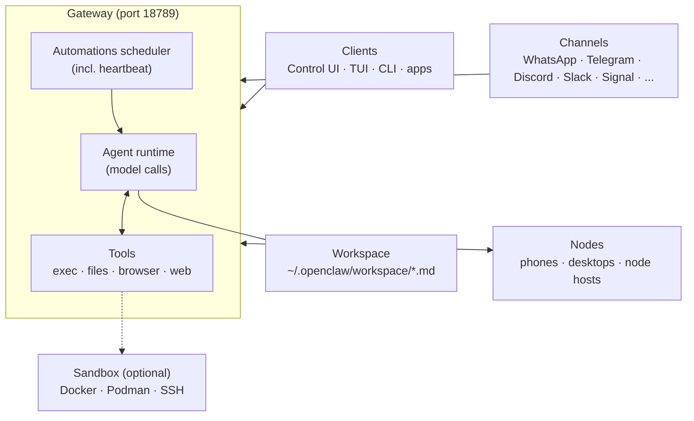

---
last_update:
  date: 2026-10-18
verified_with: 2026.10.4
title: Core Concepts
description: The building blocks of OpenClaw — Gateway, agent runtime, tools, workspace and memory, heartbeat and automations, channels, skills and MCP
keywords: [openclaw, openclaw architecture, how openclaw works, openclaw gateway, openclaw workspace, openclaw core concepts, openclaw heartbeat, openclaw memory system]
---

# Core Concepts

The handful of parts that make OpenClaw work, each with a link to its deep dive. Upstream's own overview is [Architecture](https://docs.openclaw.ai/concepts/architecture).

## The Gateway

The **Gateway** is a single long-running process that owns everything: sessions, the agent loop, tools, channel connections, automations and the web UI.

```bash
openclaw gateway status
```

It provides:
- One port (default **18789**, loopback only) that carries both the **WebSocket** control protocol and **HTTP** (Control UI, health probes, optional OpenAI-compatible API).
- Connections to every configured chat channel.
- The Automations scheduler, which also drives the heartbeat.
- Token auth by default; onboarding generates the token.

It normally runs as a background service (`openclaw gateway install`, or `openclaw onboard --install-daemon`). See [Gateway](/architecture/gateway).

## Clients

Everything you use to talk to the agent is a client of the Gateway:

- **Control UI**: the web app at `http://127.0.0.1:18789/` (`openclaw dashboard`).
- **TUI**: `openclaw tui`. (`openclaw chat` runs a local embedded agent instead.)
- **CLI**: `openclaw agent --message "..."`, `openclaw status`, and the rest of the [CLI](/reference/cli).
- **Apps**: macOS, Windows Hub, Linux, iOS and Android.

## The agent runtime and models

Each **agent** has an id (the first one is `main`), a workspace, a model and its own sessions. On each turn the runtime builds a prompt from the workspace files and conversation, calls the model, runs any tool calls, and loops until the model answers.

- Models are referenced as `provider/model`, for example `anthropic/claude-opus-5-5`. Onboarding picks the default for your provider.
- Set the model with `agents.defaults.model.primary` (and `fallbacks`), or `openclaw models set`.
- Coding harnesses such as Codex and Claude Code can be plugged in as agent runtimes.

This site's [Brain and Hands](/architecture/brain-and-hands) page explains the runtime and tools in more detail.

## Tools

**Tools** are how the agent acts: `exec` (shell), `read`, `write`, `edit` and `apply_patch` (files), `browser`, `web_search`, `web_fetch`, memory tools, messaging and more. Control them with:

- `tools.profile` (`minimal`, `coding`, `messaging`, `full`) and `tools.allow` / `tools.deny`.
- `tools.exec.mode` (`deny`, `allowlist`, `ask`, `auto`, `full`). **The default is `full`: no approval prompts.**
- `agents.defaults.sandbox.mode` (`off`, `non-main`, `all`). **The default is `off`: tools run on the host.**

:::warning
Tools run with the permissions of the user running OpenClaw. Turn on approvals (`openclaw config set tools.exec.mode ask`) and read [Security Hardening](/security/hardening) before you connect channels that other people can message.
:::

## Nodes

A **node** is a paired device (iPhone, Android phone, Mac, Windows PC, or a headless `openclaw node` host) that offers device-local capabilities to the Gateway: camera, screen, location, canvas, notifications or running commands on that machine. Pairing is approved with `openclaw devices` / `openclaw nodes`. See [Nodes](https://docs.openclaw.ai/nodes).

## The workspace and memory

Each agent has a **workspace**, by default `~/.openclaw/workspace`. It holds plain Markdown files you can read and edit:

```
~/.openclaw/
├── openclaw.json              # Config (not in the workspace)
├── agents/main/agent/         # Per-agent database: auth profiles, sessions, transcripts
└── workspace/
    ├── AGENTS.md              # Operating instructions (incl. a "## Tools" notes section)
    ├── SOUL.md                # Persona, tone, boundaries
    ├── USER.md                # Stable facts and preferences about you (optional)
    ├── IDENTITY.md            # Name, vibe, emoji
    ├── MEMORY.md              # Curated long-term memory (optional)
    ├── DREAMS.md              # Dreaming sweep summaries (optional)
    ├── memory/
    │   └── 2026-10-18.md      # Daily notes
    └── skills/                # Workspace skills
```

`AGENTS.md`, `SOUL.md`, `USER.md`, `IDENTITY.md` and `MEMORY.md` are injected at the start of a session (with size limits). Daily notes are searched on demand with the memory tools. A nightly **dreaming** sweep, on by default, promotes durable facts into `MEMORY.md`.

Memory is:
- **Persistent**: it survives restarts and updates.
- **Yours**: files on your disk, in Markdown, editable by hand.
- **Not private from your model provider**: memory text goes into prompts, and memory search uses **OpenAI embeddings by default**, so chunks are sent to the embedding API too. Use a local embedding provider if that matters.

See [Memory System](/architecture/memory-system) and upstream [Memory](https://docs.openclaw.ai/concepts/memory).

## Heartbeat and automations

The **heartbeat** makes OpenClaw proactive. It is a scheduled turn in the agent's main session, every **30 minutes** by default, or **1 hour** when Anthropic is authenticated with OAuth or a Claude CLI token (and you have not set `every`). The agent checks for anything that needs attention and replies `NO_REPLY` when there is nothing to say, so you are not spammed.

- Configure it under `agents.defaults.heartbeat` (`every`, `activeHours`, `model`, `isolatedSession`, `lightContext`, `target`).
- A short standing checklist lives in the heartbeat's monitor scratch (`openclaw cron scratch <jobId> --set "..."`).
- Jobs on a fixed schedule ("daily at 9am", "every Monday") are **automations**: `openclaw cron add` (`openclaw automations create` is the same command). They can run in an isolated session and deliver results to a channel.

`HEARTBEAT.md` is retired: the runtime no longer reads it, and `openclaw doctor --fix` migrates an old one. See [Heartbeat](/architecture/heartbeat) and the official [heartbeat docs](https://docs.openclaw.ai/gateway/heartbeat).

## How they fit together



## SOUL.md (persona)

`SOUL.md` in the workspace defines *who* the agent is: personality, tone and boundaries. It is loaded into every session; the [Quick Start](/getting-started/quick-start#step-6-personalize-your-agent-optional) has a starter file. A rule written there ("never make purchases without approval") is an instruction the model usually follows, not an enforced control; approvals and tool policy enforce. Operating rules ("how to work") belong in `AGENTS.md`; persona ("who to be") in `SOUL.md`. Because the agent can write to its own workspace, these files are also an [attack surface](/security/hardening#soulmd-protection) for prompt injection. See the [SOUL.md Guide](/guides/soul-md).

## Skills

**Skills** are directories containing a `SKILL.md` file: YAML front matter with a `name` and `description`, and Markdown instructions that teach the agent when and how to use its tools.

```markdown title="~/.openclaw/workspace/skills/weather-briefing/SKILL.md"
---
name: weather-briefing
description: Give a short weather briefing when the user asks about weather or a forecast.
---

# Weather Briefing

When asked about the weather, use `web_search` for current conditions
and reply with temperature, conditions and any weather alerts.
```

Skills load from the workspace `skills/` folder (highest precedence), `~/.openclaw/skills/` (managed), bundled skills and a few other locations. Community skills are on [ClawHub](/guides/clawhub) and are installed with `openclaw skills install`. See [Skill Development](/guides/skill-development) and upstream [Skills](https://docs.openclaw.ai/tools/skills).

:::warning
Malicious skills have been published to ClawHub. Read a skill before installing it, and see [Skill Verification](/security/skill-verification).
:::

## MCP (Model Context Protocol)

**MCP** connects the agent to external tool servers: databases, APIs, SaaS apps. Servers are configured under `mcp.servers`. A local (stdio) server takes an executable in `command` and its arguments in `args`:

```json5 title="~/.openclaw/openclaw.json"
{
  mcp: {
    servers: {
      filesystem: {
        command: "npx",
        args: ["-y", "@modelcontextprotocol/server-filesystem", "/home/me/projects"],
      },
    },
  },
}
```

Remote servers use `url` instead. For GitHub, use GitHub's own [github-mcp-server](https://github.com/github/github-mcp-server); the old `@modelcontextprotocol/server-github` package is deprecated. You can also manage entries with `openclaw mcp set` / `openclaw mcp list`. See [MCP Servers](/guides/mcp-servers).

## Multiple agents

You can run several **agents** on one Gateway, each with its own workspace, model and channel bindings (configured under `agents.entries.<id>`), and agents can spawn **sub-agents** for parallel work. Every extra agent turn costs tokens, so use parallelism where it pays off. See [Multi-Agent Workflows](/guides/multi-agent).

## Next steps

- [Architecture Overview](/architecture/overview): each component in more depth
- [Basic Usage](/guides/basic-usage): common patterns and workflows
- [Configuration](/reference/configuration): how `openclaw.json` works
- [First 7 Days](/guides/first-7-days): a structured learning path
