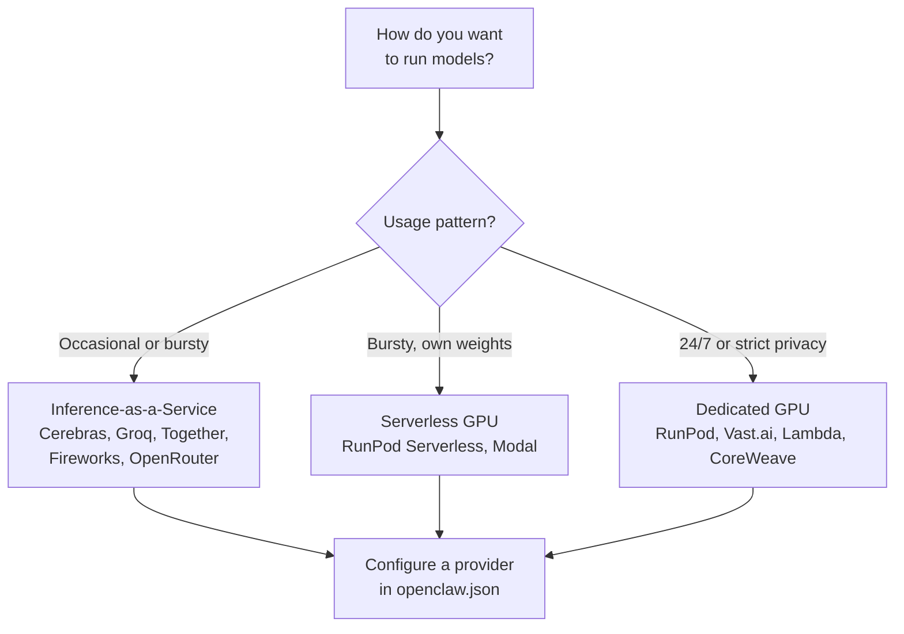

---
last_update:
  date: 2026-10-18
verified_with: 2026.10.4
title: Cloud GPU & Self-Hosted Models
description: Run your own LLMs on cloud GPUs with RunPod, Vast.ai, and inference-as-a-service providers, with dated costs, tested configuration, and model recommendations
keywords: [openclaw, openclaw cloud gpu, runpod, self-hosted llm, vllm cloud]
---

# Cloud GPU & Self-Hosted Models

No local GPU, but you want open-weight models instead of (or alongside) per-token frontier APIs? You have two options: rent a GPU and run your own inference server, or pay per token at an inference provider that hosts open models. Both connect to OpenClaw the same way, as an entry under `models.providers`.

:::tip
For running models on **your own hardware**, see [Local Models](/guides/local-models). This page covers **cloud-hosted** inference.
:::

:::warning Config is strict
OpenClaw validates `openclaw.json` against a strict schema; an unknown key stops the Gateway from starting. Run `openclaw config validate` after every edit.
:::

## Quick Decision Guide



---

## GPU Cloud Providers

### Dedicated GPU Cloud

Rent GPUs by the hour and run your own inference server (vLLM, SGLang, Ollama).

Prices are approximate on-demand list prices **as of 2026-10-18**, taken from each provider's pricing page. They change often and vary by region and availability; check the linked page before you budget.

| Provider | GPU | VRAM | Price/hr | Monthly (24/7, ~730 h) | Notes |
|----------|-----|------|----------|----------------|-------|
| [**RunPod**](https://www.runpod.io/pricing) | RTX 4090 | 24 GB | $0.34 community / $0.89 secure | ~$250 / ~$650 | Per-second billing |
| [**RunPod**](https://www.runpod.io/pricing) | A100 80GB | 80 GB | $1.19-$1.79 | ~$870-$1,310 | 70B quantized, 32B full precision |
| [**RunPod**](https://www.runpod.io/pricing) | H100 80GB | 80 GB | $1.99-$3.99 | ~$1,450-$2,910 | PCIe vs SXM, community vs secure |
| [**Lambda**](https://lambda.ai/pricing) | A100 40GB | 40 GB | $1.99 | ~$1,450 | Simple pricing |
| [**Lambda**](https://lambda.ai/pricing) | H100 80GB | 80 GB | $3.29 PCIe / $4.29 SXM | ~$2,400 / ~$3,130 | |
| [**Vast.ai**](https://vast.ai/pricing) | Various | Various | Marketplace (live) | Varies | Auction/marketplace model, usually cheapest, less predictable |
| [**CoreWeave**](https://www.coreweave.com/pricing) | A100 / H100 | 80 GB | See pricing page | | Enterprise, InfiniBand |
| [**AMD Developer Cloud**](https://devcloud.amd.com/) | MI300X | 192 GB | See site | | Check the site for current credit offers |

### GPU Size Guide

| GPU | VRAM | Fits (weights only, roughly) | Best For |
|-----|------|----------------|----------|
| RTX 4090 | 24 GB | 8-14B at 16-bit, 32B at Q4 | Daily driver, coding |
| A100 40GB | 40 GB | 14B at 16-bit, 70B at Q4 (tight) | Production serving |
| A100 / H100 80GB | 80 GB | 32B at 16-bit, 70B at 8-bit or Q4 | Large models |
| MI300X | 192 GB | 70B at 16-bit | Largest models |

A 70B model at 16-bit needs about 140 GB for weights alone, so it needs two 80 GB GPUs or one MI300X. Leave headroom for the KV cache: OpenClaw sends a large system prompt, tools and history on every turn.

### RunPod Setup

RunPod has a vLLM deployment template:

1. Create an account at [runpod.io](https://www.runpod.io).
2. Deploy a **GPU Pod** with the vLLM template.
3. Set the model name, for example `Qwen/Qwen3-32B`.
4. Set **Max Model Length** to the context you want (32768 is a reasonable start).
5. Set an API key for the server, and note the endpoint URL once it is up.

```json5 title="~/.openclaw/openclaw.json"
{
  agents: {
    defaults: {
      model: { primary: "runpod/Qwen/Qwen3-32B" },
    },
  },
  models: {
    providers: {
      runpod: {
        baseUrl: "https://your-pod-id-8000.proxy.runpod.net/v1",
        apiKey: "${RUNPOD_VLLM_API_KEY}",
        api: "openai-completions",
        timeoutSeconds: 300,
        models: [
          { id: "Qwen/Qwen3-32B", name: "Qwen3 32B (RunPod)", contextWindow: 32768, maxTokens: 8192 },
        ],
      },
    },
  },
}
```

`RUNPOD_VLLM_API_KEY` here is whatever key you gave vLLM (`--api-key`), not your RunPod account key. Keep `contextWindow` equal to the server's `--max-model-len`.

#### RunPod Serverless

Serverless endpoints scale to zero when idle, which suits bursty use. As of 2026-10-18 RunPod lists serverless at about $4.79/h for H100 and $2.72/h for A100, billed only while a worker runs ([pricing](https://www.runpod.io/pricing)). Cold starts add latency to the first turn after an idle spell; raise the provider's `timeoutSeconds`.

### Vast.ai Setup

Vast.ai is a marketplace: prices are often lower than RunPod, but host reliability varies.

1. Browse GPUs at [vast.ai](https://vast.ai).
2. Pick a GPU and the Docker image `vllm/vllm-openai:latest`.
3. Set the start command with your model and `--api-key`.
4. Note the endpoint URL and configure it like the RunPod example above.

---

## Inference-as-a-Service

These providers host open-weight models behind an API. You pay per token; there is no server to manage. Several are first-class OpenClaw providers, so you set a key and pick a model instead of writing a custom provider.

| Provider | OpenClaw integration | Auth env var | Notes |
|----------|---------------------|--------------|-------|
| [**Cerebras**](https://www.cerebras.ai) | Official plugin `@openclaw/cerebras-provider`; default model `cerebras/gemma-4-31b` (preview); `cerebras/gpt-oss-120b` is the production reasoning model | `CEREBRAS_API_KEY` | Very high output speed |
| [**Groq**](https://groq.com/pricing) | Official plugin `@openclaw/groq-provider`; suggested `groq/openai/gpt-oss-120b` | `GROQ_API_KEY` | Low latency; also audio transcription |
| [**Together AI**](https://www.together.ai/pricing) | Bundled `together` provider | `TOGETHER_API_KEY` | Llama, DeepSeek, Kimi, GLM and more |
| [**Fireworks AI**](https://fireworks.ai/pricing) | Official plugin `@openclaw/fireworks-provider` | `FIREWORKS_API_KEY` | Open-weight models and routers |
| [**OpenRouter**](https://openrouter.ai) | Bundled `openrouter` provider; refs `openrouter/<author>/<slug>` | `OPENROUTER_API_KEY` | One key, many upstream providers |
| [**Hugging Face**](https://huggingface.co/pricing) | Provider page upstream | `HF_TOKEN` | See [Hugging Face](https://docs.openclaw.ai/providers/huggingface) |
| [**Modal**](https://modal.com/pricing) | Custom provider | your key | Serverless GPUs running your own vLLM |

Per-token prices differ per model and change often, so check the linked pricing pages. OpenClaw's usage view shows the cost estimates it applies (`openclaw gateway usage-cost`).

### Setting API keys

Put keys in the global env file `~/.openclaw/.env` (or export them in the Gateway's environment):

```bash title="~/.openclaw/.env"
CEREBRAS_API_KEY=your-key-here
GROQ_API_KEY=your-key-here
TOGETHER_API_KEY=your-key-here
OPENROUTER_API_KEY=your-key-here
```

Keep the file readable only by you (`chmod 600 ~/.openclaw/.env`). Onboarding can also store keys for you, for example `openclaw onboard --auth-choice together-api-key`.

### Plugin providers

Cerebras, Groq and Fireworks ship as official plugins. Install, then onboard:

```bash
openclaw plugins install @openclaw/cerebras-provider
openclaw onboard --auth-choice cerebras-api-key
```

Then select a model:

```json5 title="~/.openclaw/openclaw.json"
{
  agents: {
    defaults: {
      model: {
        primary: "anthropic/claude-sonnet-5-5",
        fallbacks: ["cerebras/gpt-oss-120b"],
      },
    },
  },
}
```

Upstream pages: [Cerebras](https://docs.openclaw.ai/providers/cerebras), [Groq](https://docs.openclaw.ai/providers/groq), [Fireworks](https://docs.openclaw.ai/providers/fireworks), [Together](https://docs.openclaw.ai/providers/together), [OpenRouter](https://docs.openclaw.ai/providers/openrouter).

### Custom OpenAI-Compatible Provider

For any other host with an OpenAI-compatible API:

```json5 title="~/.openclaw/openclaw.json"
{
  models: {
    providers: {
      "my-host": {
        baseUrl: "https://inference.example.com/v1",
        apiKey: "${MY_HOST_API_KEY}",
        api: "openai-completions",
        models: [
          { id: "meta-llama/Llama-3.3-70B-Instruct", name: "Llama 3.3 70B" },
        ],
      },
    },
  },
}
```

Custom providers must declare `baseUrl` and a `models` array. If you omit `api`, it defaults to `openai-completions`.

---

## Inference Server Options

If you rent your own GPU, you need an inference server. These expose OpenAI-compatible endpoints (Ollama also has its own native API, which OpenClaw prefers):

| Server | Best For | Throughput | Setup |
|--------|----------|-----------|-------|
| **vLLM** | Production, multi-user | Highest | `pip install vllm` or the `vllm/vllm-openai` image |
| **SGLang** | High throughput, RadixAttention | High | `pip install sglang` |
| **Ollama** | Quick start | Good (few users) | Single binary |
| **llama.cpp** (`llama-server`) | CPU-only, edge, GGUF | Good | Binary or build |
| **TGI** (Hugging Face) | Enterprise | High | Docker |
| **TabbyAPI** | Consumer GPUs (EXL2) | Fast | Python |
| **LM Studio** | Desktop with GUI | Good | App download |

### vLLM (Recommended for Cloud)

```bash
pip install vllm

vllm serve Qwen/Qwen3-32B \
  --host 0.0.0.0 \
  --port 8090 \
  --max-model-len 32768 \
  --api-key "$VLLM_API_KEY"
```

`--host 0.0.0.0` exposes the server on every interface. On a cloud box, keep `--api-key` set and put TLS or a tunnel in front (see [Security](#security)).

```json5 title="~/.openclaw/openclaw.json"
{
  agents: {
    defaults: {
      model: { primary: "gpu-box/Qwen/Qwen3-32B" },
    },
  },
  models: {
    providers: {
      "gpu-box": {
        baseUrl: "https://your-server.example.com/v1",
        apiKey: "${VLLM_API_KEY}",
        api: "openai-completions",
        timeoutSeconds: 300,
        models: [
          { id: "Qwen/Qwen3-32B", name: "Qwen3 32B", contextWindow: 32768, maxTokens: 8192 },
        ],
      },
    },
  },
}
```

vLLM supports NVIDIA (CUDA) and AMD (ROCm) GPUs. More options (discovery, `"vllm/*"`, serving limits): [vLLM provider](https://docs.openclaw.ai/providers/vllm).

### TabbyAPI (Consumer GPUs)

TabbyAPI uses ExLlamaV2/V3 for speed on RTX 3090/4090 with EXL2/GPTQ quantized models. Follow the [TabbyAPI README](https://github.com/theroyallab/tabbyAPI) for install; it exposes an OpenAI-compatible API that you configure like the custom provider above.

---

## OpenClaw Configuration Notes

### Where things live

| File | Purpose |
|------|---------|
| `~/.openclaw/openclaw.json` | Providers, models, agents, Gateway config |
| `~/.openclaw/.env` | API keys and other secrets (keep it `600`) |

### Key rules

| Rule | Detail |
|------|--------|
| `baseUrl` | OpenAI-compatible servers usually end in `/v1`. Ollama's native API must **not** have `/v1`. Copy the URL from the provider's docs |
| `api` | Optional on custom providers (defaults to `openai-completions`); use `openai-responses` only if the server supports `/v1/responses` |
| `models` | An array of `{ id, name, ... }`; `id` is provider-local, with no provider prefix |
| Env substitution | `${ENV_VAR}` works in config values |
| Model refs | Select models as `provider-id/model-id` |
| Context window | Keep `contextWindow` at or below the server's `--max-model-len` |

### How OpenClaw picks a model

There is no global provider ranking. OpenClaw uses the explicit `agents.defaults.model.primary`, then the `fallbacks` in order when a provider errors, and rotates auth profiles within a provider. Per-agent overrides go in `agents.entries.<id>.model`. See [Models](https://docs.openclaw.ai/concepts/models).

---

## Cost Comparison

### When Self-Hosting Wins

- You run agents **24/7** and per-token spend would exceed the GPU rental
- **Privacy** is a hard requirement: no data leaves infrastructure you control
- You already have GPU hardware or credits
- You want to **fine-tune** models for your tasks

### When API Keys Win

- You need **frontier-quality** reasoning
- Usage is **intermittent**: a rented GPU bills by the hour whether or not the agent is busy
- You value time over money: hosted APIs need no maintenance
- Long multi-step agent tasks, where tool-calling reliability matters most

A 24/7 RTX 4090 pod costs about $250-$650 a month (above). Compare that with your actual API spend from `openclaw gateway usage-cost --days 30` rather than with guesses. For per-token prices of hosted frontier models and how to work out heartbeat cost, see [Cost Management](./cost-management.md#heartbeat-costs).

### Multi-Model Routing

Route frequent, simple work to a cheap or self-hosted model and keep a frontier model for hard tasks:

```json5 title="~/.openclaw/openclaw.json"
{
  agents: {
    defaults: {
      model: {
        primary: "anthropic/claude-opus-5-5",
        fallbacks: ["anthropic/claude-sonnet-5-5"],
      },
      heartbeat: {
        every: "1h",
        model: "gpu-box/Qwen/Qwen3-32B",
        isolatedSession: true,
        lightContext: true,
      },
    },
  },
  models: {
    providers: {
      "gpu-box": {
        baseUrl: "https://your-server.example.com/v1",
        apiKey: "${VLLM_API_KEY}",
        api: "openai-completions",
        models: [{ id: "Qwen/Qwen3-32B", name: "Qwen3 32B", contextWindow: 32768 }],
      },
    },
  },
}
```

The heartbeat then runs on your GPU box at no per-token cost. See [Model Selection](/guides/model-selection) for routing by agent.

---

## Recommended Models

:::tip
For a full model selection guide covering cloud, local and hybrid setups, see the **[Model Selection Guide](/guides/model-selection)**.
:::

### By VRAM Budget

| VRAM | Model | Use Case |
|------|-------|----------|
| **8 GB** (minimum) | Qwen3 8B, Llama 3.1 8B | Basic tasks, simple chat |
| **12-16 GB** | Qwen3 14B, DeepSeek-R1-Distill-Qwen-14B | General use, coding |
| **24 GB** (RTX 4090) | Qwen3 32B (Q4), Qwen3.5 27B (Q4) | Daily driver |
| **40-80 GB** (A100/H100) | Qwen3 32B (16-bit), Llama 3.3 70B (Q4/8-bit) | Production quality |
| **192 GB** (MI300X) | Llama 3.3 70B (16-bit) | Largest open models |

### Community Picks

- **Qwen3 32B / Qwen3.5** for coding, reasoning and tool use
- **DeepSeek-R1-Distill-Qwen-32B** for planning and reasoning-heavy work
- **Qwen 2.5 Coder 32B** for code-heavy work

These are community experience, not benchmarks. The [llama.cpp recipes](https://docs.openclaw.ai/plugins/llama-cpp) are the maintained reference in 2026.10.4; upstream adds a [recommended models](https://docs.openclaw.ai/concepts/recommended-models) page after that release.

:::warning
**Avoid models under about 8B parameters** for agent work. They hallucinate tool calls and lose track of multi-step tasks. Test real tasks before you make an open model your default; the best results with OpenClaw still come from frontier hosted models.
:::

---

## Security

If you run inference servers on cloud GPUs:

- **Use TLS** (reverse proxy) or a private tunnel (Tailscale, WireGuard, Cloudflare Tunnel); never expose a raw inference port
- **Set an API key** even on self-hosted servers (vLLM `--api-key`)
- **Restrict network access** to the OpenClaw Gateway's address
- **Run `openclaw security audit`** after changing providers
- Remember that open models have no hosted safety filters; keep tool approvals and sandboxing on

See [Security Hardening](/security/hardening) for full guidance.

## See Also

- [Local Models](/guides/local-models): running models on your own hardware
- [Cost Management](/guides/cost-management): prices, heartbeat cost, budgets
- [Brain & Hands Architecture](/architecture/brain-and-hands): how OpenClaw integrates with LLM providers
- [Configuration Reference](/reference/configuration): all model and provider settings
- [Hosting Providers](/guides/hosting-providers): managed hosting with API keys
- [Deployment Options](/guides/deployment-options): self-hosted deployment methods
