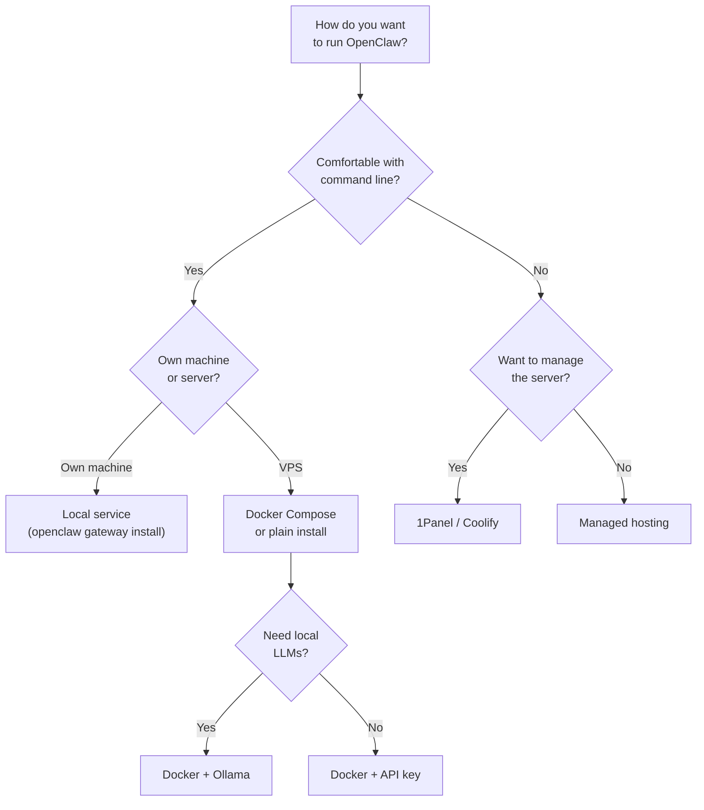

---
last_update:
  date: 2026-10-18
verified_with: 2026.10.4
title: Deployment Options
description: Compare ways to deploy OpenClaw — local service, Docker, Kubernetes, Cloudflare, 1Panel, Coolify, VPS providers, and managed hosting
keywords: [openclaw, deploy, docker, kubernetes, cloud hosting, self-host]
---

# Deployment Options

OpenClaw runs as one Gateway process with its state in `~/.openclaw/`. Every option below is a different way to supervise that process and keep that directory. This page compares them and points to the official guide for each. Commands were checked against OpenClaw 2026.10.4.

## Quick Comparison

| Method | Difficulty | Best for | Cost (as of 2026-10-18) |
|--------|-----------|----------|------|
| [Local service](#local-service) | Easy | Personal use on your own machine | Free (+ LLM API) |
| [Docker](#docker) | Medium | Self-hosters, VPS | Free (+ VPS + LLM API) |
| [Kubernetes](#kubernetes) | Hard | Clusters you already run | Free (+ cluster + LLM API) |
| [Cloudflare Containers](#moltworker) | Medium | Cloudflare users (experimental) | Workers Paid plan + container time |
| [1Panel](#1panel) | Easy | VPS with a GUI panel | Free (+ VPS + LLM API) |
| [Coolify](#coolify) | Easy | Self-hosted PaaS users | Free (+ VPS + LLM API) |
| [DigitalOcean](#digitalocean) | Easy | Simple paid VPS | About $6/mo for a 1 GB Droplet |
| [Hostinger](#hostinger) | Easy | Managed 1-Click or VPS | Varies by plan |
| [Managed hosting](#managed-hosting) | Easiest | Non-technical users | Varies |

:::danger Never expose an unauthenticated Gateway
The Gateway listens on port 18789. Keep it on loopback and reach it over an SSH tunnel or Tailscale, or put it behind token/password auth and a firewall. Since 2.0 the installer refuses network installs that would expose OpenClaw without auth. See [Security Hardening](/security/hardening) and the upstream [network exposure](https://docs.openclaw.ai/gateway/security/network-exposure) guide. Whatever you deploy, the agent can run shell commands on that host; review approvals and sandboxing before connecting channels.
:::

## Local service {#local-service}

On your own machine, install the CLI ([Installation](/getting-started/installation)), run `openclaw onboard`, then let OpenClaw install a supervised service:

```bash
openclaw gateway install      # launchd on macOS, systemd user unit on Linux, schtasks on Windows
openclaw gateway status
openclaw gateway restart
```

- **macOS:** a per-user LaunchAgent labelled `ai.openclaw.gateway`. The Gateway itself only needs Node; from 2026.10.10 (now in beta) the macOS app and the Control UI in Safari need macOS or Safari 26.2 or newer ([PR #168595](https://github.com/openclaw/openclaw/pull/168595)).
- **Linux:** a systemd **user** unit, `openclaw-gateway.service`. Inspect it with `systemctl --user status openclaw-gateway` and `journalctl --user -u openclaw-gateway -f`. On a headless server, run `sudo loginctl enable-linger $(whoami)` so it keeps running after you log out.
- After changing `gateway.port`, run `openclaw gateway install --force` so the service starts on the new port.

`openclaw gateway uninstall` removes the service. Details: [Gateway runbook](https://docs.openclaw.ai/gateway).

## Docker {#docker}

The official setup runs from a clone of the repository. There is no standalone compose file to download.

```bash
git clone https://github.com/openclaw/openclaw.git
cd openclaw

# Use the pre-built image from GHCR (primary registry) instead of building locally
export OPENCLAW_IMAGE="ghcr.io/openclaw/openclaw:latest"
./scripts/docker/setup.sh
```

`scripts/docker/setup.sh` prompts for provider keys, generates a Gateway token and writes it to `.env`, syncs the config, and starts the `openclaw-gateway` service with Docker Compose. Without `OPENCLAW_IMAGE` it builds `openclaw:local` from source, which needs about 6 GB of RAM. Open `http://127.0.0.1:18789/` and paste the token from `.env` into Settings.

What the upstream `docker-compose.yml` sets up:

| Item | Value |
|------|-------|
| Images | `ghcr.io/openclaw/openclaw` (primary) or the Docker Hub mirror `openclaw/openclaw`. Variants: `-slim`, `-browser` (Chromium included), `extended-stable`. Avoid unofficial mirrors. |
| User and state | Runs as `node`. State, config and workspace live in `/home/node/.openclaw`, bind-mounted from `~/.openclaw` on the host. Mounting `/root/.openclaw` does nothing. |
| Auth | `OPENCLAW_GATEWAY_TOKEN` from `.env`, token auth, Gateway bind mode `lan` inside the container. |
| Hardening | `cap_drop: [NET_RAW, NET_ADMIN]`, `no-new-privileges`, built-in `HEALTHCHECK` on `/healthz`. |
| Host models | `host.docker.internal` maps to the host, so a host Ollama is `http://host.docker.internal:11434`. |
| Upgrades | On start, the image runs `openclaw doctor --fix --non-interactive` against the mounted state before the Gateway starts. |

Run CLI commands through the companion service, for example `docker compose run --rm openclaw-cli dashboard --no-open`.

:::warning Published ports
The upstream compose file publishes `18789` (plus `18790` and `3978`) on **all host interfaces**, protected by the token. Docker's port publishing bypasses ordinary host `INPUT` firewall rules. On a VPS, either filter in the `DOCKER-USER` chain or restrict publishing to loopback with an override file and reach the Gateway over SSH or Tailscale:

```yaml title="docker-compose.override.yml"
services:
  openclaw-gateway:
    ports: !override
      - "127.0.0.1:18789:18789"
```

`!override` needs Docker Compose 2.24 or newer. Keep `OPENCLAW_GATEWAY_TOKEN` set either way.
:::

Health checks need no auth:

```bash
curl -fsS http://127.0.0.1:18789/healthz   # liveness
curl -fsS http://127.0.0.1:18789/readyz    # channel-aware readiness
```

Full guide: [Docker install](https://docs.openclaw.ai/install/docker), including the [networking and storage](https://docs.openclaw.ai/install/docker/networking-and-storage) notes. For rootless containers see [Podman](https://docs.openclaw.ai/install/podman).

### Docker with Local Models

Ollama is not configured through environment variables on the OpenClaw side. Point a provider at it in `openclaw.json`.

If Ollama runs on the host, start it with `OLLAMA_HOST=0.0.0.0:11434 ollama serve` so the container can reach it, and use `http://host.docker.internal:11434` as `baseUrl`. If you want Ollama in the same Compose project, add it in an override file:

```yaml title="docker-compose.override.yml"
services:
  openclaw-gateway:
    depends_on:
      - ollama
  ollama:
    image: ollama/ollama:latest
    volumes:
      - ollama-data:/root/.ollama
    restart: unless-stopped
volumes:
  ollama-data:
```

Then configure the provider. Use the native Ollama URL with no `/v1`:

```json5 title="~/.openclaw/openclaw.json"
{
  models: {
    providers: {
      ollama: {
        baseUrl: "http://ollama:11434", // service name from the compose file; no /v1
        apiKey: "ollama-local",
        api: "ollama",
        models: [{ id: "qwen3:32b", name: "qwen3:32b" }],
      },
    },
  },
  agents: {
    defaults: {
      model: { primary: "ollama/qwen3:32b" },
    },
  },
}
```

Pull the model once with `docker compose exec ollama ollama pull qwen3:32b`. For GPU passthrough, add the NVIDIA device reservation from the [Ollama Docker docs](https://hub.docker.com/r/ollama/ollama). See [Local Models](/guides/local-models) for model and context-window settings.

## Kubernetes {#kubernetes}

Upstream ships Kustomize manifests and a deploy script, not a Helm chart ("Why not Helm" in the [Kubernetes guide](https://docs.openclaw.ai/install/kubernetes)). From a clone of the repository:

```bash
export ANTHROPIC_API_KEY="..."
./scripts/k8s/deploy.sh                 # creates the namespace, Secret (with a gateway token) and Deployment
kubectl port-forward svc/openclaw 18789:18789 -n openclaw
```

Read the generated token with `kubectl get secret openclaw-secrets -n openclaw -o jsonpath='{.data.OPENCLAW_GATEWAY_TOKEN}' | base64 -d`. For a local test cluster, `./scripts/k8s/create-kind.sh` creates one with Kind. Upstream describes these manifests as a starting point, not a production deployment. Use `/healthz` and `/readyz` (or `/startupz`) for probes.

:::warning Archived Helm chart
The community chart [serhanekicii/openclaw-helm](https://github.com/serhanekicii/openclaw-helm) was **archived** in May 2026 and its chart repository URL no longer resolves. Do not start new deployments on it. Its example `gateway.host` and `brain.provider` keys are not OpenClaw config keys; the real setting is `gateway.bind` (`loopback`, `lan`, `tailnet`, `auto` or `custom`).
:::

## Cloudflare Containers (Moltworker) {#moltworker}

Upstream now has its own **experimental** Cloudflare template in [`scripts/cloudflare`](https://github.com/openclaw/openclaw/tree/main/scripts/cloudflare). It runs one Gateway in a Cloudflare Container (`standard-2`, one instance) behind a Worker and Durable Object, and replicates the SQLite databases to R2 with Litestream. Litestream protects the databases, not the whole state directory, so read the limits section of the [Cloudflare guide](https://docs.openclaw.ai/install/cloudflare) before you use production credentials.

[Moltworker](https://github.com/cloudflare/moltworker) (cloudflare/moltworker, Apache-2.0, about 9,900 stars as of 2026-10-18) is the earlier Cloudflare Sandbox port. Its README calls it "a proof of concept … not officially supported", and it has had no commits since May 2026. It needs the Workers Paid plan ($5/month) plus container compute; see its README for the cost estimate. Prefer the upstream template for new deployments.

## 1Panel {#1panel}

[1Panel](https://github.com/1Panel-dev/1Panel) is an open-source (GPL-3.0) Linux server panel, about 37,200 GitHub stars as of 2026-10-18. Its App Store has a one-click OpenClaw app, and it can run Ollama next to it. It gives you a GUI for containers, logs, backups and the firewall.

```bash
# Third-party installer: read it before you run it
curl -sSL https://resource.fit2cloud.com/1panel/package/v2/quick_start.sh -o quick_start.sh
less quick_start.sh
sudo bash quick_start.sh
```

:::warning
This is a third-party script that runs as root. Download it, read it, and only then run it. The installer prints the panel URL and credentials; keep the panel port off the public internet or restrict it by source IP.
:::

To install OpenClaw: open the panel, go to **App Store**, search for **OpenClaw**, click **Install**, enter your provider key, and confirm. 1Panel uses its own `1panel/openclaw` image on Docker Hub, not an official OpenClaw image, so it may lag official releases. Check which OpenClaw version it runs before connecting channels.

## Coolify {#coolify}

[Coolify](https://coolify.io) is a self-hosted PaaS with an OpenClaw entry in its service catalog; see the [Coolify OpenClaw docs](https://coolify.io/docs/services/openclaw). A separate community integration, [essamamdani/openclaw-coolify](https://github.com/essamamdani/openclaw-coolify) (about 150 stars, last push August 2026), adds a Docker sidecar proxy, Cloudflare Tunnel, SearXNG and pre-installed dev tools. Its build needs roughly 13 GB of free disk for the Docker build cache.

## DigitalOcean {#digitalocean}

Upstream documents a plain Droplet: Ubuntu 24.04 LTS, Basic 1 vCPU / 1 GB RAM (about $6/month, add swap), then the normal install. Upstream warns: "Avoid third-party Marketplace 1-click images unless you have reviewed their startup scripts and firewall defaults." A [Marketplace listing](https://marketplace.digitalocean.com/apps/openclaw) exists; review it on those terms. Guide: [DigitalOcean](https://docs.openclaw.ai/install/digitalocean).

## Hostinger {#hostinger}

Hostinger offers a **1-Click** managed OpenClaw plan (infrastructure, Docker and updates handled for you, with optional pre-paid AI credits) or a **VPS** you run yourself with its Docker Manager. Guide: [Hostinger](https://docs.openclaw.ai/install/hostinger).

## Other upstream targets {#other-targets}

The official docs have step-by-step guides for these, each linked to docs.openclaw.ai:

| Kind | Guides |
|------|--------|
| VPS and cloud VMs | [Hetzner](https://docs.openclaw.ai/install/hetzner), [Oracle Cloud](https://docs.openclaw.ai/install/oracle) (Always Free ARM tier), [GCP](https://docs.openclaw.ai/install/gcp), [Azure](https://docs.openclaw.ai/install/azure), [exe.dev](https://docs.openclaw.ai/install/exe-dev) |
| Platforms | [Fly.io](https://docs.openclaw.ai/install/fly), [Render](https://docs.openclaw.ai/install/render), [Railway](https://docs.openclaw.ai/install/railway), [Northflank](https://docs.openclaw.ai/install/northflank) |
| Automation | [Ansible](https://docs.openclaw.ai/install/ansible) ([openclaw/openclaw-ansible](https://github.com/openclaw/openclaw-ansible)), [Nix](https://docs.openclaw.ai/install/nix), [Docker VM runtime](https://docs.openclaw.ai/install/docker-vm-runtime) |
| Small hardware | [Raspberry Pi](https://docs.openclaw.ai/install/raspberry-pi) (Pi 4/5, 1 GB minimum) |

The Ansible install uses a system unit, so on those hosts `sudo systemctl status openclaw` is correct; everywhere else the unit is the user unit described under [Local service](#local-service).

## Managed Hosting {#managed-hosting}

Many third-party services host OpenClaw for you. See the **[Hosting Providers guide](/guides/hosting-providers)** for a comparison. A few examples (prices change; check each site):

- [Agent37](https://www.agent37.com) — low-cost shared containers
- [MyClaw.ai](https://myclaw.ai) — budget managed plans
- [WZ-IT](https://wz-it.com/en/managed-open-source/) — German managed open-source hosting
- [Clowd.bot](https://clowd.bot) — pay per launch

RunClaw.ai, listed here before, did not respond on 2026-10-18.

:::warning
With managed hosting, your conversations, credentials and data pass through a third party's infrastructure, and that party controls the host the agent runs commands on. Review the provider's privacy policy and how it handles upgrades. Self-hosting gives you full control over your data.
:::

## Choosing the Right Option



### Minimum Server Requirements

Rough guide. The API-only row follows upstream (1 GB works with swap added). Building the Docker image from source needs about 6 GB of RAM; pre-built images avoid that. Local-model figures depend on the model size.

| Setup | RAM | CPU | Storage | GPU |
|-------|-----|-----|---------|-----|
| API-only (Anthropic/OpenAI) | 1 GB + swap | 1 vCPU | 5 GB | None |
| With Ollama (small models) | 8 GB | 4 vCPU | 20 GB | Optional |
| With Ollama (large models) | 32 GB | 8 vCPU | 50 GB | Recommended |

## See Also

- [Installation](/getting-started/installation) — Local installation guide
- [Local Models](/guides/local-models) — Running with Ollama or vLLM
- [Monitoring](/guides/monitoring) — Health checks and logs for a running Gateway
- [Security Hardening](/security/hardening) — Securing any deployment
- [Hosting Providers](/guides/hosting-providers) — Managed hosting comparison
- [Ecosystem](/reference/ecosystem) — Community tools and projects
