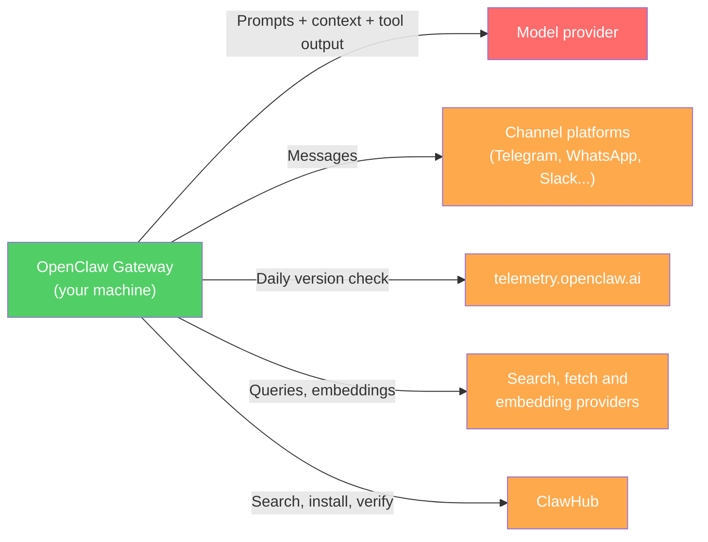

---
last_update:
  date: 2026-10-18
verified_with: 2026.10.4
title: Privacy & Compliance
description: What OpenClaw sends and stores, its update check and opt-out, where data lives on disk, deletion, and the facts that matter for GDPR, SOC 2 and HIPAA reviews
keywords: [openclaw, privacy, gdpr, compliance, data protection, telemetry, update check, air-gapped, hipaa, soc 2]
---

# Privacy & Compliance

This page sets out what OpenClaw sends off your machine, what it keeps on disk, and how to delete it. Facts come from the upstream docs for v2026.10.4 and were checked on 2026-10-18. It is not legal advice. Whether a deployment complies with GDPR, HIPAA or a SOC 2 control set depends on how you use it, so take the specifics to your own counsel or auditor.

:::warning Gartner assessment (February 2026)
Gartner called OpenClaw "a dangerous preview of agentic AI" with "insecure by default risks like plaintext credential storage", and recommended that enterprises block it unless it runs in isolated non-production VMs with throwaway credentials. Some of that has changed since: Gateway auth is now required by default, and SecretRefs can replace plaintext credentials ([Security Overview](/security/overview#what-is-on-by-default)).
:::

---

## Data flow map

### What leaves your machine



| Data | Where it goes | Details |
|------|--------------|---------|
| **Prompts and responses** | Your model provider | System prompt, conversation history and tool output on every model call |
| **Tool output** | Your model provider | Command results, file contents, browser snapshots: anything the agent reads goes back into the prompt |
| **Chat messages** | The channel platform | Stored according to that platform's policy (see [channels](#channel-encryption)) |
| **Version check** | `telemetry.openclaw.ai` | Daily by default; see [below](#does-openclaw-phone-home) |
| **Search and fetch queries** | Configured web search or fetch provider | When the agent uses web tools |
| **Memory embeddings** | Configured embedding provider | When memory search uses a remote embedding model |
| **Skill and plugin lookups** | ClawHub | `openclaw skills search`, `install`, `update` and `verify` call ClawHub directly ([`openclaw skills`](https://docs.openclaw.ai/cli/skills)) |
| **OpenTelemetry export** | Your collector | Only if you configure it ([OpenTelemetry](https://docs.openclaw.ai/gateway/opentelemetry)) |

### What stays on disk

Upstream says to assume anything under `~/.openclaw/` (or `$OPENCLAW_STATE_DIR`) may contain secrets or private data ([secrets, storage and logs](https://docs.openclaw.ai/gateway/security/secrets-and-storage)). Storage is mostly SQLite now:

| Data | Location | Notes |
|------|----------|-------|
| **Session transcripts** | `~/.openclaw/agents/<agentId>/agent/openclaw-agent.sqlite` | Private messages, tool output, pasted secrets |
| **Legacy sessions and archives** | `~/.openclaw/agents/<agentId>/sessions/` | Older installs and migration sources |
| **Memory index** | Same per-agent SQLite database | Built-in memory engine ([builtin memory](https://docs.openclaw.ai/concepts/memory-builtin)) |
| **Memory files** | `~/.openclaw/workspace/MEMORY.md`, `memory/*.md` | Plain Markdown in the workspace |
| **Model auth profiles** | Per-agent SQLite (`auth_profile_store`) | API keys and OAuth tokens |
| **Channel credentials, pairing allowlists** | `~/.openclaw/credentials/` | For example `whatsapp/<accountId>/creds.json`, `<channel>-allowFrom.json` |
| **MCP OAuth tokens, audit ledger, shared state** | `~/.openclaw/state/openclaw.sqlite` | |
| **Configuration** | `~/.openclaw/openclaw.json` | May contain tokens if you put them there |
| **Global env file** | `~/.openclaw/.env` | Plaintext |
| **Gateway logs** | `/tmp/openclaw/openclaw-YYYY-MM-DD.log` | JSONL; known secret patterns masked before writing (best-effort); rotate at 100 MB, five archives kept ([logging](https://docs.openclaw.ai/gateway/logging)) |
| **Sandbox workspaces** | `~/.openclaw/sandboxes/` | Copies of files the sandbox touched |

:::warning Changing in 2026.10.10 (beta)
In 2026.10.4, known secret patterns in tool arguments and results are masked before they reach the model and the transcript. 2026.10.10-beta.1 (npm `beta`, 2026-10-15; not in 2026.10.4) removes that masking: tool payloads and `.env` reads are stored and sent to the provider as-is, while logs, support exports and telemetry stay masked ([PR #169063](https://github.com/openclaw/openclaw/pull/169063)). Treat session transcripts as holding credentials, and review your provider's retention terms before upgrading.
:::

Nothing here is encrypted by OpenClaw. Use full-disk encryption on the Gateway host, keep `~/.openclaw` at `700` and its files at `600`, and on shared machines run the Gateway as a dedicated OS user.

### Does OpenClaw phone home? {#does-openclaw-phone-home}

**Yes, once a day by default, to check for updates.** The request is ([usage telemetry and update checks](https://docs.openclaw.ai/gateway/telemetry)):

```http
GET https://telemetry.openclaw.ai/api/latest-version
User-Agent: openclaw/<version> (<os>; node/<version>; <arch>; gateway)
```

- The `User-Agent` carries the OpenClaw version, OS, Node.js version, CPU architecture and whether the Gateway or CLI sent it. There is no body and no install, machine or tracking identifier.
- Cloudflare derives approximate location (country, region, city, timezone) from the connection. The hosted service stores those fields with each check, even when `DO_NOT_TRACK` is set. It does not store raw IPs. Records are kept for **three months**. Turning the check off does not erase existing records.
- **Anonymous feature statistics** (configured channel and provider IDs, public plugin IDs, a 24-hour session-creation count) are **off by default** and opt-in with `openclaw telemetry on` or `telemetry.enabled: true`. When on, they ride along with the same daily request.
- `DO_NOT_TRACK=1` forces feature statistics off but does **not** stop the update check.
- Nothing is sent when the `CI` environment variable is truthy.
- Prompts, messages, model names, API keys, file paths, hostnames and account IDs are never included.

See exactly what would be sent:

```bash
openclaw telemetry show
```

Turn off **every** automatic update request, feature statistics and update notice:

```json5 title="~/.openclaw/openclaw.json"
{
  update: { checkOnStart: false },
  telemetry: { enabled: false },
}
```

`OPENCLAW_NO_AUTO_UPDATE=1` in the Gateway's environment does the same. Explicit `openclaw update` still works. `OPENCLAW_TELEMETRY_ENDPOINT` points the check at your own server instead; the server source is [openclaw/telemetry](https://github.com/openclaw/telemetry).

Headless node hosts have a separate auto-update policy, `nodeHost.autoUpdate.enabled`, which is **on by default**. `update.checkOnStart: false` or `OPENCLAW_NO_AUTO_UPDATE=1` also disables it ([config: update](https://docs.openclaw.ai/gateway/config-runtime)).

The third-party [Knostic telemetry plugin](https://github.com/knostic/openclaw-telemetry) is a separate, opt-in add-on. It writes JSONL locally and can also forward to syslog or a SIEM.

---

## Channel encryption {#channel-encryption}

| Channel | Encryption | Privacy notes |
|---------|-----------|-------------|
| **Signal** | End-to-end | Minimal metadata collection |
| **iMessage** | End-to-end | Apple ecosystem only |
| **WhatsApp** | End-to-end | Meta collects metadata. OpenClaw uses the WhatsApp Web protocol, which is not an official bot API; automating a personal account may breach WhatsApp's terms and risks a ban. |
| **Telegram** | Client–server only | Bot chats are never end-to-end: the Bot API doesn't support secret chats. Messages are stored on Telegram's servers. |
| **Discord** | TLS in transit | Discord retains message content |
| **Slack** | TLS in transit | Workspace admins can access messages |

End-to-end encryption protects the message in transit only. The Gateway decrypts it, sends it to your model provider, and stores it in the transcript.

Keep DM pairing or an allowlist on every channel ([access control](https://docs.openclaw.ai/gateway/security/access-control)). A bot that accepts messages from anyone is also processing strangers' personal data.

---

## GDPR

### Roles

OpenClaw is software you run, not a service, so the GDPR roles fall on you and your providers:

- **Purely personal use** may fall under the household exemption ([GDPR Art. 2(2)(c)](https://eur-lex.europa.eu/eli/reg/2016/679/oj)).
- **Once you process other people's data**, for example in group chats, shared inboxes or for an organisation, the operator is typically the **controller**. The model provider is usually a **processor** under its data processing terms. Channel platforms may be processors or independent controllers, depending on the service and its terms.
- OpenClaw gives you technical controls. Lawful basis, transparency, DPIAs, records of processing and data subject requests remain your job.

Data does leave your infrastructure: to the model provider, the channel platforms, any search or embedding providers, ClawHub, and the update check. Map each one.

### Model provider terms

Check the current terms yourself; these change. As of 2026-10-18:

- **Anthropic** says it automatically deletes API inputs and outputs within 30 days, with exceptions for zero-data-retention agreements, services with longer retention, and usage-policy enforcement ([Anthropic Privacy Center](https://privacy.anthropic.com)). A DPA is part of its commercial terms.
- **OpenAI** says it does not train on API business data by default and offers a DPA to API customers ([OpenAI enterprise privacy](https://openai.com/enterprise-privacy/)).
- Zero-data-retention arrangements are contract-specific. Read the agreement, not a summary.

### Deletion requests

There is no single "erase this person" command. The relevant tools ([`openclaw memory`](https://docs.openclaw.ai/cli/memory), [`openclaw sessions`](https://docs.openclaw.ai/cli/sessions)):

```bash
# Memory derived from one participant's sessions (preview first; it deletes without asking)
openclaw memory forget --agent <agent-id> --participant <actor-id> --dry-run --json
openclaw memory forget --agent <agent-id> --participant <actor-id>

# The sessions themselves
openclaw sessions --agent <agent-id> --json
openclaw sessions delete "<session-key>" --agent <agent-id> --dry-run
openclaw sessions delete "<session-key>" --agent <agent-id>
```

Know the limits:

- `memory forget` removes memory artifacts derived from the selected sessions. The **source transcripts are retained**.
- `sessions delete` removes sessions and their live artifacts. Retained archives can remain searchable.
- Also check the workspace memory files (`MEMORY.md`, `memory/*.md`), legacy `agents/<id>/sessions/` archives, logs in `/tmp/openclaw/`, sandbox copies, your backups, the copies on the channel platform, and the model provider's retention.
- `openclaw memory reset` clears the derived index and embedding cache for an agent without deleting sessions.
- Don't empty `~/.openclaw/credentials/` as an erasure step. It holds channel logins and pairing lists, and deleting it breaks channels without removing anyone's messages.

By default, `session.maintenance` archives eligible sessions after **30 days** and caps the store at 5,000 unarchived entries (`pruneAfter: "30d"`, `maxEntries: 5000`, `mode: "enforce"`; [session maintenance](https://docs.openclaw.ai/concepts/session)). Archiving keeps the transcript in place and restorable; it is not deletion. Disposable automation sessions (cron, hooks, heartbeat, sub-agents) are deleted at their cutoff. Shorten the window if you keep less, and use `sessions delete` for real removal:

```json5 title="~/.openclaw/openclaw.json"
{
  session: {
    maintenance: { mode: "enforce", pruneAfter: "14d", maxEntries: 2000 },
  },
}
```

Sessions can also be given **Public access**, a link anyone can read without signing in. Only the session creator or a Gateway admin can turn it on ([multi-user mode](https://docs.openclaw.ai/concepts/multi-user)). Check for public sessions before you call a deployment private.

### Data residency and transfers

Hosting in the EU and running a local model does not by itself make processing compliant, and GDPR doesn't require EU residency. Transfers outside the EEA are lawful under an adequacy decision (including the EU–US Data Privacy Framework for certified US companies) or appropriate safeguards such as standard contractual clauses (GDPR Chapter V). If you want to minimise transfers anyway:

| Goal | Approach |
|-------------|----------|
| EU hosting | Any EU region or provider |
| Local inference | A local model ([Local Models](/guides/local-models), [upstream local models](https://docs.openclaw.ai/gateway/local-models)) |
| No update check | `update.checkOnStart: false` |
| Self-hosted messaging | A self-hosted Matrix homeserver. Channels such as Telegram and WhatsApp always route through their operators. |

---

## Enterprise reviews

### SOC 2

SOC 2 is an auditor's report on an organisation's controls. Software doesn't "inherit" it. A self-hosted Gateway is simply in scope of your controls, and you need evidence for them. Facts reviewers usually ask about:

- **Transport.** The Gateway serves plain HTTP and WebSocket on loopback by default. TLS is optional (`gateway.tls`), and plaintext `ws://` is accepted for loopback, private IPs, `.local` and Tailscale `*.ts.net` addresses ([network exposure](https://docs.openclaw.ai/gateway/security/network-exposure)). For remote access, use Tailscale Serve, Cloudflare Access, or TLS at your own proxy ([Security Hardening: remote access](/security/hardening#remote-access)).
- **Audit trail.** The built-in audit ledger is **metadata-only**. It records which agent ran, tool actions and outcomes, and, if `logging.audit.messages` is `direct` or `all`, message delivery states. It never stores prompts, message bodies, tool arguments, tool results, URLs or command output. Queries return at most 30 days, and the ledger is capped at 100,000 rows. Upstream says it "is not a lossless compliance archive" and recommends an external system fed by OpenTelemetry for that ([audit history](https://docs.openclaw.ai/gateway/audit)). Inspect it with `openclaw audit`.
- **Content records** are the session transcripts in the per-agent database, subject to `session.maintenance` pruning.
- **Access control.** Gateway auth is required by default. Named operator roles (`gateway.roles`) and operator scopes limit what each connection can do. Trusted-proxy and Cloudflare Access sign-in give per-person identities ([operator scopes](https://docs.openclaw.ai/gateway/operator-scopes), [trusted proxy auth](https://docs.openclaw.ai/gateway/trusted-proxy-auth)). Upstream is clear that these are collaboration guardrails, not isolation between people who don't trust each other ([SECURITY.md](https://github.com/openclaw/openclaw/blob/main/SECURITY.md)).
- **Change and patch management.** Advisories are frequent (722 as of 2026-10-18), so include `openclaw update` and `openclaw plugins update --all` in your patch process ([Known Vulnerabilities](/security/known-vulnerabilities)).
- **Providers.** Anthropic and OpenAI publish SOC 2 Type II reports through their trust portals ([Anthropic Trust Center](https://trust.anthropic.com), [OpenAI Trust Portal](https://trust.openai.com)).

### HIPAA

- **Business associate agreements** from model providers cover only eligible products and configurations under a signed agreement. Confirm that the exact API and features you use are covered.
- **Channels are the bigger gap.** Consumer messaging services such as Telegram, WhatsApp, Discord and free Slack plans generally don't sign BAAs. Routing PHI through them is a problem regardless of the model.
- **A local model is not "complete PHI isolation".** HIPAA's Security Rule requires administrative, physical and technical safeguards, including risk analysis, access control and audit controls, wherever the model runs.
- **Audit controls.** The built-in ledger is metadata-only by design. If you need content-level audit records, build them with an external system.
- Redact or minimise PHI before it reaches the model where you can.

### Air-gapped and isolated deployments

OpenClaw can run fully offline with a local model, with these caveats:

- Turn off the update check (`update.checkOnStart: false` or `OPENCLAW_NO_AUTO_UPDATE=1`), or the Gateway keeps attempting it. It also disables node auto-update.
- Every chat channel except local ones (Control UI, TUI) needs the internet.
- ClawHub installs and `openclaw skills verify` need network access. Install from reviewed local directories instead (`openclaw skills install ./dir`).
- Turn on the sandbox for tool execution (`agents.defaults.sandbox.mode`). The Docker backend's default is `network: "none"`, so sandboxed tools have no egress ([Docker backend](https://docs.openclaw.ai/gateway/sandboxing/docker-backend)).

### Network segmentation

- Keep the Gateway on loopback and reach it through an SSH tunnel, Tailscale Serve or Cloudflare Access ([Security Hardening](/security/hardening#remote-access)).
- Don't give it access to internal services or databases it doesn't need.
- Docker: publish the port to `127.0.0.1` only. Docker-published ports bypass host firewalls such as ufw ([firewall](/security/hardening#firewall)).
- Restrict outbound traffic to the providers you use.

---

## API key protection

1. **Prefer SecretRefs** (`env`, `file`, `exec` or `store` sources) over plaintext in `openclaw.json` ([secrets management](https://docs.openclaw.ai/gateway/secrets)). Exec providers integrate with 1Password, Bitwarden, Vault, `pass` and `sops`.
2. **Environment variables and `.env` are plaintext too.** Upstream warns that plaintext in `openclaw.json`, `.env` and similar files stays readable by the agent.
3. **The global env file is `~/.openclaw/.env`**, with the leading dot. Provider keys and `OPENCLAW_*` variables are blocked from workspace `.env` files.
4. **Check for leftovers** with `openclaw secrets audit --check`.
5. **Set file permissions:** `chmod 700 ~/.openclaw` and `chmod 600` on its files, or run `openclaw security audit --fix`.
6. **Never commit** `openclaw.json`, `.env` or `credentials/` to version control.
7. **Rotate keys** after any incident ([incident response](/security/hardening#incident-response)).

```bash title="~/.openclaw/.env (chmod 600)"
ANTHROPIC_API_KEY=sk-ant-xxxxx
OPENAI_API_KEY=sk-xxxxx
```

---

## Regulatory context

### EU AI Act

- Most of the AI Act has applied since **2 August 2026** (Art. 113). Obligations for general-purpose AI models have applied since 2 August 2025, but they bind the **providers of those models**, not someone self-hosting OpenClaw with a provider's API.
- Whether your use is "high-risk" depends on the use case, such as the Annex III areas of employment, credit and essential services. Being an "agent" doesn't decide it.
- The European Commission proposed changes to the high-risk timeline in its November 2025 "Digital Omnibus". Check the current status before relying on any date.

Source: [Regulation (EU) 2024/1689](https://eur-lex.europa.eu/eli/reg/2024/1689/oj).

### Corporate and government responses

In February 2026, several Korean companies restricted OpenClaw on work networks, and China's NVDB warned about badly configured deployments. See the table on [Known Vulnerabilities](/security/known-vulnerabilities#government-and-corporate-responses-early-2026).

---

## Known security incidents

| Incident | Date | Impact |
|----------|------|--------|
| **CVE-2026-25253** (CVSS 8.8, High) | Fixed 2026-01-30, disclosed 2026-01-31 | One-click token theft from the Control UI |
| **Moltbook database breach** | 2026-01-31 | 1.5M agent API tokens and 35K emails exposed by a separate service |
| **Exposed instances** | Feb 2026 | 40,000+ reachable Gateways in third-party scans |
| **ClawHavoc campaign** | Late Jan 2026 | 335 skills distributing Atomic Stealer macOS malware |
| **ClawHub malicious skills** | Feb 2026 | 341 malicious skills; 283 leaking credentials |
| **Advisory batches** | 2026-06-30, 2026-09-11 | 45 and 75 advisories, all fixed in released versions |

Full details, the 14 critical advisories and the minimum version are on [Known Vulnerabilities](/security/known-vulnerabilities).

---

## Compliance summary

| Aspect | Status as of 2026-10-18 | What to do |
|--------|--------|----------------|
| Data stays on your host | Partly | Model, channel, search/embedding and ClawHub calls leave it |
| Phones home | Daily update check by default; feature statistics opt-in | `update.checkOnStart: false` or `OPENCLAW_NO_AUTO_UPDATE=1` |
| GDPR | Depends on your use | Map processors, set retention, document a lawful basis |
| SOC 2 | Your controls, your evidence | External content logging if a control needs it |
| HIPAA | Depends on BAAs and channels | No consumer chat channels for PHI |
| Encryption at rest | Not provided | Full-disk encryption |
| Credentials | Plaintext unless you use SecretRefs | SecretRefs, `openclaw secrets audit --check` |
| Access control | Auth required; operator roles and scopes | Separate Gateways for people who don't trust each other |
| Gateway exposure | Loopback by default; Docker setup binds `lan` | Publish Docker ports to `127.0.0.1` |
| ClawHub skills | Scanned, but third-party | Review before installing ([Skill Verification](/security/skill-verification)) |

---

## See also

- [Security Overview](/security/overview): defaults and trust model
- [Security Hardening](/security/hardening): the self-hosting checklist
- [Known Vulnerabilities](/security/known-vulnerabilities): advisories and incidents
- [Local Models](/guides/local-models): local inference
- [Deployment Options](/guides/deployment-options): self-hosted deployment methods
- Upstream: [Usage telemetry and update checks](https://docs.openclaw.ai/gateway/telemetry) · [Secrets, storage and logs](https://docs.openclaw.ai/gateway/security/secrets-and-storage) · [Audit history](https://docs.openclaw.ai/gateway/audit)
