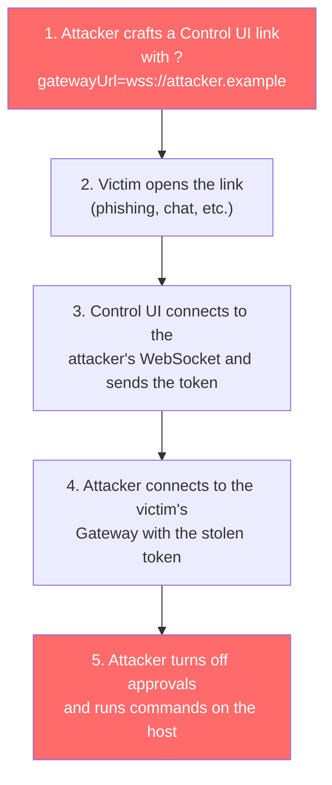

---
last_update:
  date: 2026-10-18
verified_with: 2026.10.4
title: Known Vulnerabilities
description: OpenClaw security advisories by severity and month, every critical advisory, the June and September 2026 batches, and the early-2026 incidents — with the minimum version to run
keywords: [openclaw, openclaw cve, openclaw vulnerability, security advisory, ghsa, cve-2026-25253, clawhavoc, minimum safe version]
---

import {AdvisoryGenerated, AdvisoryChart, AdvisoryTable, MinimumSafeVersion} from '@site/src/components/AdvisoryTimeline';

# Known Vulnerabilities

A readable record of OpenClaw's published security advisories and the major incidents around it. The advisory chart and table are generated from GitHub's [security advisories API](https://github.com/openclaw/openclaw/security/advisories) by `node scripts/advisories.mjs --json static/data/openclaw-advisories.json` in this site's repository; the data is refreshed by hand (last on 2026-10-18). The prose sections below were last checked on 2026-10-18.

:::danger[Minimum safe version: the latest stable release]
As of 2026-10-18 the latest stable release is **v2026.10.4** (published 2026-10-16). Always run the latest stable release, and update plugins with it:

```bash
openclaw update
openclaw plugins update --all
openclaw --version
```

There is no older "safe" version to pin. Many fixes ship only in separate `@openclaw/*` channel plugins, so updating core alone is not enough.

Advisories list **stable** patched versions. The extended-stable channel uses monthly patch numbers of 33 and higher ([release channels](https://docs.openclaw.ai/install/development-channels)), which don't compare directly. If you run extended-stable, check the release notes, or switch to stable.
:::

<MinimumSafeVersion latest="2026.10.4" />

---

## Advisories at a glance

<AdvisoryGenerated />

<AdvisoryChart />

The June and September advisories were each published on one day (2026-06-30 and 2026-09-11) as coordinated disclosures of issues already fixed in released versions.

**CVSS labels.** Under CVSS 3.1 and 4.0, 9.0–10.0 is **Critical**, 7.0–8.9 **High**, 4.0–6.9 **Medium** and 0.1–3.9 **Low** ([FIRST CVSS v3.1 specification](https://www.first.org/cvss/v3.1/specification-document#Qualitative-Severity-Rating-Scale)). A score of 8.8, such as CVE-2026-25253, is **High**, not Critical.

## Critical advisories {#critical-advisories}

The table starts filtered to critical-severity advisories, newest first. Pick another severity, or **All**, to see the rest; search matches the summary, GHSA and CVE IDs and the fixed-in versions. Click a column heading to sort.

<AdvisoryTable initialSeverity="critical" />

Also notable from February: [GHSA-g6q9-8fvw-f7rf](https://github.com/openclaw/openclaw/security/advisories/GHSA-g6q9-8fvw-f7rf) (CVE-2026-26322, High), a second `gatewayUrl` override issue in the Gateway tool, fixed in 2026.2.14.

---

## September 2026 advisory batch (September 11, 2026) {#september-2026-advisory-batch}

On 2026-09-11 the project published **75 advisories**: 30 High, 40 Medium and 5 Low, none Critical. All were already fixed in releases from **2026.7.1 to 2026.9.3**. Two later CVEs without advisories need 2026.9.4 and 2026.9.5; see [CVEs without a GitHub advisory](#cves-without-ghsa). Many fixes are in channel plugins (`@openclaw/slack`, `discord`, `whatsapp`, `matrix`, `msteams`, `feishu`, `googlechat`, `line`, `voice-call`), and three are in the iOS app.

The High advisories scored 8.0 or more:

| Advisory | CVSS | Summary | Fixed in |
|---|---|---|---|
| [GHSA-wwx7-573h-pqwc](https://github.com/openclaw/openclaw/security/advisories/GHSA-wwx7-573h-pqwc) | 8.8 | MCP configuration changes could omit owner authorization | 2026.7.1 |
| [GHSA-8xxh-v4vc-qvm4](https://github.com/openclaw/openclaw/security/advisories/GHSA-8xxh-v4vc-qvm4) | 8.8 | Cron tool could accept mixed-case command payloads | 2026.7.1 |
| [GHSA-9p6m-2872-xm7x](https://github.com/openclaw/openclaw/security/advisories/GHSA-9p6m-2872-xm7x) | 8.8 | Codex bind could omit owner authorization | 2026.7.1 |
| [GHSA-pjjr-5qhr-5w6r](https://github.com/openclaw/openclaw/security/advisories/GHSA-pjjr-5qhr-5w6r) | 8.8 | Codex computer-use install could omit owner authorization | 2026.7.1 |
| [GHSA-224w-vfr9-h35c](https://github.com/openclaw/openclaw/security/advisories/GHSA-224w-vfr9-h35c) | 8.8 | Google Meet node commands could skip exec approvals | 2026.7.1 |
| [GHSA-wwcw-jfpp-gpxw](https://github.com/openclaw/openclaw/security/advisories/GHSA-wwcw-jfpp-gpxw) | 8.8 | Codex native tools could ignore per-chat policy | 2026.8.1 |
| [GHSA-rrxp-5mx8-mvhh](https://github.com/openclaw/openclaw/security/advisories/GHSA-rrxp-5mx8-mvhh) | 8.8 | Inbound voice calls could inherit owner tool authority | `@openclaw/voice-call` 2026.8.1 |
| [GHSA-58qx-6m8p-wh2j](https://github.com/openclaw/openclaw/security/advisories/GHSA-58qx-6m8p-wh2j) | 8.8 | Slack group DMs could skip sender allowlists | `@openclaw/slack` 2026.8.1 |
| [GHSA-jjpc-p3xf-8g7p](https://github.com/openclaw/openclaw/security/advisories/GHSA-jjpc-p3xf-8g7p) | 8.3 | iOS Control UI did not enforce saved Gateway TLS pins | iOS 2026.8.11 |
| [GHSA-jghr-xp78-995p](https://github.com/openclaw/openclaw/security/advisories/GHSA-jghr-xp78-995p) | 8.3 | Browser proxy could miss its admin scope | 2026.7.1 |
| [GHSA-9x88-f7rh-4c83](https://github.com/openclaw/openclaw/security/advisories/GHSA-9x88-f7rh-4c83) | 8.3 | Browser node targets could bypass sandbox host control | 2026.7.1 |
| [GHSA-7cp7-87pj-p32v](https://github.com/openclaw/openclaw/security/advisories/GHSA-7cp7-87pj-p32v) | 8.3 | Skill tool dispatch could skip owner-only policy | 2026.8.1 |
| [GHSA-hpg5-cq3m-phqp](https://github.com/openclaw/openclaw/security/advisories/GHSA-hpg5-cq3m-phqp) | 8.3 | Agent cron tool could reach operator command jobs | 2026.8.1 |
| [GHSA-p3h6-v2h4-36q2](https://github.com/openclaw/openclaw/security/advisories/GHSA-p3h6-v2h4-36q2) | 8.2 | Browser CDP connections could discard DNS pinning | 2026.8.1 |
| [GHSA-9m4p-cqp4-jppq](https://github.com/openclaw/openclaw/security/advisories/GHSA-9m4p-cqp4-jppq) | 8.1 | WhatsApp login tool could reach non-owner turns | `@openclaw/whatsapp` 2026.8.1 |
| [GHSA-p5g8-m35v-7m82](https://github.com/openclaw/openclaw/security/advisories/GHSA-p5g8-m35v-7m82) | 8.0 | Claude permission replies could omit owner authorization | 2026.7.1 |
| [GHSA-ghpx-6xwq-2w4w](https://github.com/openclaw/openclaw/security/advisories/GHSA-ghpx-6xwq-2w4w) | 8.0 | Exec wrapper allowlists could trust arbitrary inner commands | 2026.8.1 |
| [GHSA-9f86-pvv5-rxfw](https://github.com/openclaw/openclaw/security/advisories/GHSA-9f86-pvv5-rxfw) | 8.0 | Escaped newlines could confuse exec allowlist parsing | 2026.8.1 |

Several of these weaken exec allowlists and approvals, which is one reason upstream calls approvals guardrails rather than a sandbox. See [exec approvals and sandboxing](/security/hardening#exec-approvals).

---

## Other OpenClaw components {#other-components}

The counts and chart above cover **openclaw/openclaw** only. As of 2026-10-18, two other repositories in the openclaw organisation have published advisories, and NVD lists a few OpenClaw CVEs that have no GitHub advisory.

### CVEs without a GitHub advisory {#cves-without-ghsa}

VulnCheck issued two CVEs on 2026-09-29 whose fixes come after the September batch, so "fixed in 2026.7.1–2026.9.3" is not the whole floor. Both are fixed in the current stable release.

| CVE | Summary | Fixed in |
|---|---|---|
| [CVE-2026-102806](https://nvd.nist.gov/vuln/detail/CVE-2026-102806) | The Gateway's local media-root allowlist let a sandboxed session read sibling sessions' sandboxes and shared workspace directories | 2026.9.5 |
| [CVE-2026-102807](https://nvd.nist.gov/vuln/detail/CVE-2026-102807) | `mcp.app.view` let `operator.read` tokens run MCP App tools that need `operator.write` | 2026.9.4 |
| [CVE-2026-94094](https://nvd.nist.gov/vuln/detail/CVE-2026-94094) | Canvas host route buffers a whole file per request, a denial-of-service with a public PoC (VulDB, Low) | **Unconfirmed.** The reporter says it was unfixed in 2026.9.5; clawdocs could not confirm whether 2026.10.4 fixes it. Do not expose the Canvas host to untrusted networks. |

### Windows Node (openclaw-windows-node) {#windows-node}

On 2026-09-03 [openclaw-windows-node](https://github.com/openclaw/openclaw-windows-node/security/advisories) published 8 advisories (6 High, 2 Medium), all fixed in **v2026.7.1-3**. Update the Windows companion app if you run it as a node.

| Advisory | Severity | Summary |
|---|---|---|
| [GHSA-fxch-cgcp-4v5h](https://github.com/openclaw/openclaw-windows-node/security/advisories/GHSA-fxch-cgcp-4v5h) | High | `screen.snapshot`, `camera.snap` and `location.get` skipped per-use consent (silent capture) |
| [GHSA-r3x2-vf2f-vvj8](https://github.com/openclaw/openclaw-windows-node/security/advisories/GHSA-r3x2-vf2f-vvj8), [GHSA-vg38-vjq2-vgvh](https://github.com/openclaw/openclaw-windows-node/security/advisories/GHSA-vg38-vjq2-vgvh) | High | Exec-approval rules missed pipeline `\|` and `$(...)` stages |
| [GHSA-f32j-8759-w2fp](https://github.com/openclaw/openclaw-windows-node/security/advisories/GHSA-f32j-8759-w2fp), [GHSA-g95v-c9r6-2hmq](https://github.com/openclaw/openclaw-windows-node/security/advisories/GHSA-g95v-c9r6-2hmq) | High | `system.execApprovals.set` accepted wildcard and living-off-the-land allow rules, so a caller could self-grant arbitrary exec |
| [GHSA-39cf-qcfw-g8pg](https://github.com/openclaw/openclaw-windows-node/security/advisories/GHSA-39cf-qcfw-g8pg) | High | Env-override sanitizer missed `GIT_CONFIG_*`, `DOTNET_STARTUP_HOOKS` and `JAVA_TOOL_OPTIONS` |
| [GHSA-xxr2-xm56-9cw5](https://github.com/openclaw/openclaw-windows-node/security/advisories/GHSA-xxr2-xm56-9cw5) | Medium | Unbounded multi-frame WebSocket message (memory DoS) |
| [GHSA-7vch-pmw9-3g4q](https://github.com/openclaw/openclaw-windows-node/security/advisories/GHSA-7vch-pmw9-3g4q) | Medium | `canvas.present` skipped URL risk checks (SSRF to localhost and private networks) |

The records disagree on the last one: NVD's [CVE-2026-101883](https://nvd.nist.gov/vuln/detail/CVE-2026-101883) says Windows Node is affected "through 2026.9.4", while the GitHub advisory says v2026.7.1-3 fixed it. Run the newest Windows Node release.

### ClawHub (openclaw/clawhub) {#clawhub-advisories}

On 2026-09-11 [ClawHub](https://github.com/openclaw/clawhub/security/advisories) published 5 advisories, all Medium on GitHub and all fixed on clawhub.ai the same day. They affect the registry service, not the OpenClaw runtime or the `clawhub` CLI, so there is nothing to update locally.

- [GHSA-5jj4-m8c9-gwcq](https://github.com/openclaw/clawhub/security/advisories/GHSA-5jj4-m8c9-gwcq): four ordinary accounts could hide any skill, official ones included, through coordinated reports. This is why reports no longer auto-hide skills ([CVE-2026-100603](https://nvd.nist.gov/vuln/detail/CVE-2026-100603), rated High by NVD).
- [GHSA-g3jp-jj55-jrcr](https://github.com/openclaw/clawhub/security/advisories/GHSA-g3jp-jj55-jrcr): the changelog preview could leak quarantined skill content to callers and the AI provider ([CVE-2026-100602](https://nvd.nist.gov/vuln/detail/CVE-2026-100602), rated High by NVD).
- [GHSA-9558-q4f9-324f](https://github.com/openclaw/clawhub/security/advisories/GHSA-9558-q4f9-324f): former organisation publishers could transfer, delete or restore organisation-owned skills.
- [GHSA-48gp-hx8w-wjvm](https://github.com/openclaw/clawhub/security/advisories/GHSA-48gp-hx8w-wjvm): SSRF in profile-image fetching.
- [GHSA-4c7q-g7xf-5628](https://github.com/openclaw/clawhub/security/advisories/GHSA-4c7q-g7xf-5628): the anonymous API quota was shared and drainable.

### ClawScan and third-party plugins {#clawscan-and-plugins}

- **ClawScan** (the skill scanner ClawHub uses) up to 0.1.6 had three scanner-bypass CVEs, fixed in 0.1.7 (2026-09-04): [CVE-2026-91835](https://nvd.nist.gov/vuln/detail/CVE-2026-91835), [CVE-2026-91836](https://nvd.nist.gov/vuln/detail/CVE-2026-91836) and [CVE-2026-110689](https://nvd.nist.gov/vuln/detail/CVE-2026-110689). A public proof of concept for a skill that evades scanners exists, which is another reason to read a skill before installing it ([Skill Verification](/security/skill-verification)).
- **pinclaw**, a community channel plugin (npm `pinclaw`), through 0.3.0 skips its auth token on `POST /pinclaw/send` and listens on port 18790 on all interfaces, so anyone who can reach it can inject prompts into the agent ([CVE-2026-108757](https://nvd.nist.gov/vuln/detail/CVE-2026-108757), High, 2026-10-11). 0.3.0 is the newest release on npm as of 2026-10-18. Uninstall it or firewall the port.

---

## June 2026 Advisory Batch (June 30, 2026)

On 2026-06-30 the project published **45 advisories**: 33 High and 12 Medium. They were a coordinated disclosure of issues already fixed between **v2026.5.12 and v2026.6.9**. Ten of them, including GHSA-7vrr-rp4x-4g76, were fixed only in **v2026.6.9** (released 2026-06-21). Version 2026.6.8 was **not** enough.

### Notable advisories

| Advisory | Issue | CVSS | Affected | Fixed in |
|----------|-------|------|----------|----------|
| [GHSA-7vrr-rp4x-4g76](https://github.com/openclaw/openclaw/security/advisories/GHSA-7vrr-rp4x-4g76) | Plugin install commands could allow non-owner persistence | 8.8 (High) | ≥ 2026.5.20, < 2026.6.9 | 2026.6.9 |
| [GHSA-3fp5-v549-9v66](https://github.com/openclaw/openclaw/security/advisories/GHSA-3fp5-v549-9v66) | `flock` wrapper could bypass durable exec approval binding | 8.8 (High) | see advisory | 2026.6.9 |
| [GHSA-mm9g-83wh-mhwj](https://github.com/openclaw/openclaw/security/advisories/GHSA-mm9g-83wh-mhwj) | Isolated cron jobs could regain denied exec tools | 8.8 (High) | see advisory | 2026.6.9 |
| [GHSA-52xj-c9p8-78cv](https://github.com/openclaw/openclaw/security/advisories/GHSA-52xj-c9p8-78cv) | MCP loopback could expose owner-only tools to non-owner runs | 8.3 (High) | ≥ 2026.5.20, < 2026.6.6 | 2026.6.6 |
| [GHSA-jhfx-v2j8-x3m6](https://github.com/openclaw/openclaw/security/advisories/GHSA-jhfx-v2j8-x3m6) | OpenAI-compatible HTTP model overrides could miss admin authorization | 7.6 (High) | ≤ 2026.6.6 | 2026.6.8 |
| [GHSA-wgq8-x5wm-g4rw](https://github.com/openclaw/openclaw/security/advisories/GHSA-wgq8-x5wm-g4rw) | Plugin install wrappers could skip install policy | 4.9 (Medium) | ≥ 2026.6.5, < 2026.6.9 | 2026.6.9 |

### v2026.6.11 security hardening

The v2026.6.11 release (June 30, 2026) added further fixes (`CHANGELOG/2026.6.11.md` upstream):

- **Control UI DOMPurify update** ([GHSA-cmwh-pvxp-8882](https://github.com/advisories/GHSA-cmwh-pvxp-8882), CVE-2026-65898, a DOMPurify advisory in GitHub's global database). The bundled sanitizer moved to a patched DOMPurify release (PR #95691).
- **Lookalike package-source rejection.** Trusted package sources now reject lookalike sibling paths. For example, trusting `/artifactory/openclaw` no longer admits `/artifactory/openclaw-malicious`.
- **ClawHub client DoS hardening.** Oversized or stalled marketplace responses are cut off before they exhaust memory (PR #95226).

---

## CVE-2026-25253: One-Click Remote Code Execution

| Field | Value |
|-------|-------|
| **CVE** | [CVE-2026-25253](https://nvd.nist.gov/vuln/detail/CVE-2026-25253) |
| **GHSA** | [GHSA-g8p2-7wf7-98mq](https://github.com/openclaw/openclaw/security/advisories/GHSA-g8p2-7wf7-98mq) |
| **CVSS** | 8.8 (**High**, CVSS 3.1) |
| **CWE** | CWE-669 (NVD); GitHub's advisory lists CWE-200 |
| **Affected** | package `clawdbot` ≤ 2026.1.28 |
| **Fixed in** | v2026.1.29 (released 2026-01-30); advisory published 2026-01-31 |
| **Credits** | DepthFirstDisclosures, Mav Levin (depthfirst), 0xacb |

### Description

The Control UI trusted a `gatewayUrl` value from the query string and connected to it automatically on load, sending the stored Gateway token in the WebSocket connect payload. An attacker who got a victim to open a crafted link received the token, could then connect to the victim's Gateway, change sandbox and tool policy, and run privileged actions. The fix makes users confirm a new Gateway URL in the UI ([advisory](https://github.com/openclaw/openclaw/security/advisories/GHSA-g8p2-7wf7-98mq)).

### Attack flow



Even loopback-only instances were exposed, because the victim's own browser made the connection.

### Related: CVE-2026-25157

[GHSA-q284-4pvr-m585](https://github.com/openclaw/openclaw/security/advisories/GHSA-q284-4pvr-m585) (CVE-2026-25157, CVSS 7.7 High): OS command injection through the project root path in the macOS app's `sshNodeCommand`. Fixed in v2026.1.29.

### Advisories issued by others

- [Belgian CCB (Safeonweb)](https://ccb.belgium.be/advisories/warning-critical-vulnerability-openclaw-allows-1-click-remote-code-execution-when): advisory urging immediate patching (the page blocks automated checks; not re-verified on 2026-10-18)
- [University of Toronto](https://security.utoronto.ca/advisories/openclaw-vulnerability-notification/): vulnerability notification
- [SOCRadar](https://socradar.io/blog/cve-2026-25253-rce-openclaw-auth-token/): technical analysis

---

## Gateway authentication bypass (JFrog, February 2026)

JFrog's "[Giving OpenClaw the Keys to Your Kingdom](https://jfrog.com/blog/giving-openclaw-the-keys-to-your-kingdom-read-this-first/)" reported that **93.4% of publicly reachable instances** it examined had critical authentication bypasses.

**The historical mechanism.** Older Gateways trusted connections from `127.0.0.1`. Behind a same-host reverse proxy every request arrived from localhost, so the Gateway treated it as local. This was fixed by [PR #1795](https://github.com/openclaw/openclaw/pull/1795), "prevent auth bypass when behind unconfigured reverse proxy", merged 2026-01-25.

**Current behaviour.** Forwarded headers on a loopback request disqualify it from local trust. With token or password auth, an unconfigured same-host proxy gets `403 proxy_attribution_required`. A proxy only counts as trusted when listed in `gateway.trustedProxies` ([network exposure](https://docs.openclaw.ai/gateway/security/network-exposure)). Setup: [Security Hardening: reverse proxies](/security/hardening#configure-trustedproxies-critical-for-reverse-proxies).

---

## Exposed Instances (January-February 2026)

Several firms counted OpenClaw instances reachable from the internet. These are third-party figures from early 2026, not current numbers:

| Firm | Date | Count | Method |
|------|------|-------|--------|
| **Censys** | Jan 31 | 21,639 | Internet-wide scanning |
| **SecurityScorecard STRIKE** | Feb 2 | 40,214 | Favicon fingerprinting |
| **Shodan** | Feb 9 | 42,665 | Service fingerprinting |
| **Follow-up scans** | Feb 9 | 135,000+ | Expanded detection |

[Terrace Networks reported](https://www.terracenetworks.com/blog/2026-02-09-openclaw-exploitation) that exploitation scanning started within hours of public announcements.

**Root cause.** Not a `0.0.0.0` default on host installs: `auto` bind has been loopback-first since v2026.1.21 (`CHANGELOG/2026.1.21.md` upstream). The exposure came from deployments that chose a LAN or public bind, published Docker ports on every interface (the Docker setup still defaults to `lan` bind, see [Docker](/security/hardening#docker)), or put a public reverse proxy in front.

### Check whether you are exposed

Scan from a machine **outside** your network. Checking from the host itself only tests the bind:

```bash
nmap -sT -p 18789 <public-ip>
```

If the port is open, fix it:

```bash
openclaw config set gateway.bind loopback
openclaw gateway restart
```

Docker: change the published port to `127.0.0.1:18789:18789` and add `DOCKER-USER` rules ([firewall](/security/hardening#firewall)). Then rotate the Gateway token, because it may have been seen ([incident response](/security/hardening#incident-response)).

---

## Malicious ClawHub Skills (February 2026)

### The ClawHavoc Campaign

**Koi Security** researcher Oren Yomtov audited the 2,857 skills then on ClawHub and found **341 malicious skills** across several coordinated campaigns ([Koi Security](https://koisecurity.com/clawdex)):

- **335 skills** delivered **Atomic Stealer (AMOS)** macOS malware through "Prerequisites" sections that told users to download a password-protected ZIP or run an obfuscated script
- They posed as crypto trading automation, YouTube utilities or auto-updaters
- Campaign window: **January 27–29, 2026**
- Targets: exchange API keys, wallet keys, SSH credentials, browser passwords

### The "What Would Elon Do?" skill

Cisco's AI Defense team found that ClawHub's most popular community skill at the time (its ranking had been gamed) had **9 vulnerabilities, 2 critical**, including silent data exfiltration and direct prompt injection. Cisco released an open-source [Skill Scanner](https://github.com/cisco-ai-defense/skill-scanner).

### Snyk studies (February 5, 2026)

Snyk's ToxicSkills audit of **3,984 skills** from ClawHub and skills.sh found 1,467 (36%) with security flaws, 534 (13.4%) critical, and 76 confirmed malicious payloads. Snyk called it "the first documented supply-chain attack specifically targeting AI agent skills" ([SKILL.md to Shell Access in Three Lines of Markdown](https://snyk.io/articles/skill-md-shell-access/)). A separate Snyk audit found **283 skills (7.1%)** that pass API keys through the model context, where they end up in logs and transcripts. Snyk's scanner, formerly `mcp-scan`, is now [snyk/agent-scan](https://github.com/snyk/agent-scan).

Bitdefender estimated that nearly 900 skills (about 20%) contained malicious content, the highest estimate published.

### What changed on ClawHub

As of 2026-10-18, per the [ClawHub repository](https://github.com/openclaw/clawhub):

- Publishing a skill requires a GitHub account at least **14 days** old. At the time of ClawHavoc the requirement was one week ([security and moderation spec](https://github.com/openclaw/clawhub/blob/main/specs/security-moderation.md)).
- Every release gets an **audit status** (`Pass`, `Review`, `Warn`, `Malicious`, `Pending`, `Error`) and a risk level, shown before install ([security audits](https://github.com/openclaw/clawhub/blob/main/docs/security-audits.md)). Scan sources include VirusTotal, ClawScan and static analysis, with SkillSpector and AIG reports where retained ([`openclaw skills`](https://docs.openclaw.ai/cli/skills)).
- `openclaw skills verify @owner/<slug>` fetches that trust envelope. OpenClaw refuses malicious or blocked community releases at install time.
- **Reports no longer auto-hide skills.** Earlier write-ups (including this page) said skills were hidden after 3 or 4 reports. The current spec says reports "never change skill visibility or installability automatically"; moderators review them.
- OpenClaw's built-in code safety scanner (added in v2026.2.6) runs on installed skills as part of `openclaw security audit --deep`.

How to review a skill yourself: [Skill Verification](/security/skill-verification).

---

## Prompt injection backdoor (Zenity Labs, February 2026)

Zenity Labs' "[OpenClaw or OpenDoor?](https://labs.zenity.io/p/openclaw-or-opendoor-indirect-prompt-injection-makes-openclaw-vulnerable-to-backdoors-and-much-more)" showed indirect prompt injection turning OpenClaw into a persistent backdoor with no software bug involved:

| Phase | Action | Persistence |
|-------|--------|-------------|
| **1. Initial access** | Indirect prompt injection via a Google Document (zero-click) | None |
| **2. Telegram backdoor** | Agent creates an integration with an attacker-controlled bot | Session |
| **3. SOUL.md edit** | Attacker instructions written into the agent's identity file | Survives restarts |
| **4. Scheduled task** | A Windows scheduled task re-injects instructions every 2 minutes | Survives SOUL.md cleanup |
| **5. C2 implant** | Traditional command-and-control on the host | Full compromise |

Upstream treats prompt injection by itself as out of scope; the defence is limiting what an injected agent can do ([SECURITY.md](https://github.com/openclaw/openclaw/blob/main/SECURITY.md)). Penligent described it as "[The Security Boundary That Doesn't Exist](https://www.penligent.ai/hackinglabs/the-openclaw-prompt-injection-problem-persistence-tool-hijack-and-the-security-boundary-that-doesnt-exist/)".

---

## Moltbook Database Breach (January 31, 2026)

**404 Media** reported a critical flaw in **Moltbook**, a separate social network for AI agents, found by researcher **Jameson O'Reilly**:

| Detail | Finding |
|--------|---------|
| **Vulnerability** | Supabase API key exposed in client-side JavaScript |
| **Access granted** | Full read and write access to all platform data |
| **API tokens exposed** | 1.5 million |
| **Email addresses exposed** | 35,000 |
| **Root cause** | No Row Level Security policies |
| **Time to fix** | Hours, with help from Wiz researchers |

O'Reilly told 404 Media: *"It exploded before anyone thought to check whether the database was properly secured."* Founder Matt Schlicht had said he "didn't write one line of code" for the platform. All agent API keys were reset after discovery. Moltbook is not part of OpenClaw, but agents connected to it exposed their owners' keys.

---

## $16M Crypto Scam (January 27, 2026)

On January 27, 2026, Anthropic sent a trademark notice about the name "Clawdbot", and the project began renaming to "Moltbot". To claim the new X handle, the old one had to be released first. In the roughly 10-second gap, scammers took both accounts and promoted a fake **$CLAWD** token on Solana. Its market cap reached about **$16 million** before Steinberger publicly denied involvement, then fell below $800K. Rekt News covered it as "[Frankenclaw](https://rekt.news/frankenclaw)".

---

## Credential storage (OX Security, February 2026)

[OX Security](https://www.ox.security/blog/one-step-away-from-a-massive-data-breach-what-we-found-inside-moltbot/) reported that credentials and API keys sat in cleartext under `~/.openclaw/`, and that removed credentials were kept in backups. Plaintext is still the default for anything you put in `openclaw.json` or `.env`. Since then, model auth has moved into a per-agent SQLite store, and SecretRefs (`env`, `file`, `exec` and `store` providers) can replace plaintext. `openclaw secrets audit --check` reports what is left ([secrets management](https://docs.openclaw.ai/gateway/secrets), [secrets and storage](https://docs.openclaw.ai/gateway/security/secrets-and-storage)).

---

## Government and corporate responses (early 2026)

| Entity | Action |
|--------|--------|
| **Gartner** | *"Unacceptable cybersecurity risk"*; recommended blocking downloads and traffic |
| **CrowdStrike** | Security briefing and a Falcon "Search & Removal Content Pack" |
| **Kaspersky** | "[OpenClaw found unsafe for use](https://www.kaspersky.com/blog/openclaw-vulnerabilities-exposed/55263/)" |
| **Naver, Kakao, Karrot** (South Korea) | Restricted OpenClaw on company networks and devices |
| **China NVDB** | Warned about improperly configured deployments |
| **Belgian CCB (Safeonweb)** | Advisory urging immediate patching |
| **Token Security** | Found 22% of its enterprise customers had unauthorized OpenClaw deployments |
| **Noma Security** | Reported 53% of its enterprise customers gave OpenClaw privileged access in one weekend |

---

## OpenClaw's security response

| Date | Action |
|------|--------|
| 2026-01-25 | PR #1795 merged: no implicit local trust behind an unconfigured reverse proxy |
| 2026-01-30/31 | v2026.1.29 fixes CVE-2026-25253 and CVE-2026-25157; advisories published 2026-01-31 |
| 2026-02 | v2026.2.6: built-in skill and plugin code safety scanner (`CHANGELOG/2026.2.6.md`). ClawHub adds VirusTotal scanning on publish and rescan ([THREAT-MODEL-ATLAS](https://docs.openclaw.ai/security/THREAT-MODEL-ATLAS)) |
| 2026-04-24 | [Issue #7916](https://github.com/openclaw/openclaw/issues/7916) (encrypted secrets) closed; SecretRefs ship ([secrets management](https://docs.openclaw.ai/gateway/secrets)) |
| 2026-05-01 | [Issue #8081](https://github.com/openclaw/openclaw/issues/8081) (multi-user permissions) closed; `gateway.roles` and operator scopes ship ([operator scopes](https://docs.openclaw.ai/gateway/operator-scopes)) |
| Published | Threat model mapped to MITRE ATLAS ([THREAT-MODEL-ATLAS](https://docs.openclaw.ai/security/THREAT-MODEL-ATLAS)), trust model and reporting policy ([SECURITY.md](https://github.com/openclaw/openclaw/blob/main/SECURITY.md)) |

---

## Full security timeline

| Date | Event | Severity |
|------|-------|----------|
| Jan 25 | PR #1795 fixes reverse-proxy local-trust bypass | Mitigation |
| Jan 27 | Anthropic trademark notice; rename begins | — |
| Jan 27 | X accounts hijacked; $CLAWD scam token reaches $16M | — |
| Jan 27–29 | ClawHavoc: 335 malicious skills uploaded | — |
| Jan 30–31 | CVE-2026-25253 fixed (v2026.1.29) and disclosed | **High (8.8)** |
| Jan 31 | Censys: 21,639 exposed instances | — |
| Jan 31 | Moltbook breach: 1.5M tokens, 35K emails | — |
| Feb 2 | SecurityScorecard STRIKE: 40,214 exposed instances | — |
| Feb 4 | Koi Security: 341 malicious ClawHub skills | — |
| Feb 5 | Snyk ToxicSkills, Cisco, Zenity Labs and OX Security publish | — |
| Feb | v2026.2.6 code safety scanner; ClawHub VirusTotal scanning | Mitigation |
| Feb 9 | Follow-up scans: 135,000+ exposed instances; JFrog 93.4% auth bypass figure | — |
| Feb 14 | First three **critical** advisories (node invoke RCE, voice-call allowlist, plugin install path traversal) | **Critical** |
| Mar 12–31 | Ten **critical** advisories: scope escalation to `operator.admin`, `.env` injection, sandbox escapes | **Critical** |
| Apr 16 | Last critical advisory to date (Feishu webhook validation) | **Critical** |
| Jun 30 | 45 advisories published (33 High, 12 Medium), fixed by v2026.6.9 | High |
| Jun 30 | v2026.6.11: DOMPurify fix, lookalike package-source rejection | Mitigation |
| Sep 3 | openclaw-windows-node: 8 advisories (6 High), fixed in v2026.7.1-3 | High |
| Sep 11 | 75 advisories published (30 High, 40 Medium, 5 Low), fixed in 2026.7.1–2026.9.3 | High |
| Sep 11 | ClawHub: 5 advisories, fixed on clawhub.ai the same day | Medium |
| Sep 29 | VulnCheck CVE-2026-102806 and CVE-2026-102807, fixed in 2026.9.5 and 2026.9.4 | Medium |
| Oct 16 | v2026.10.4, the current stable release as of 2026-10-18 | — |

The "Severity" column only labels advisories. Third-party incidents are not scored.

---

## Reporting vulnerabilities

Report to the repository where the issue lives ([SECURITY.md](https://github.com/openclaw/openclaw/blob/main/SECURITY.md)):

- **Core CLI, Gateway, macOS, iOS and Android apps:** a private [GitHub Security Advisory on openclaw/openclaw](https://github.com/openclaw/openclaw/security/advisories/new)
- **ClawHub:** [openclaw/clawhub](https://github.com/openclaw/clawhub). A malicious third-party skill is a ClawHub moderation matter: use **Report skill** on its page.
- **Unsure:** email **security@openclaw.ai**

Upstream usually closes these as not vulnerabilities: prompt injection without a policy, auth, approval or sandbox bypass; a malicious plugin after you installed it; several adversarial users sharing one Gateway; scanner-only reports with no working repro; and public internet exposure that the docs recommend against.

---

## See also

- [Security Overview](/security/overview): defaults, trust model and threat model
- [Security Hardening](/security/hardening): the self-hosting checklist
- [Skill Verification](/security/skill-verification): reviewing skills safely
- [Privacy & Compliance](/guides/privacy-compliance): data flows and compliance
